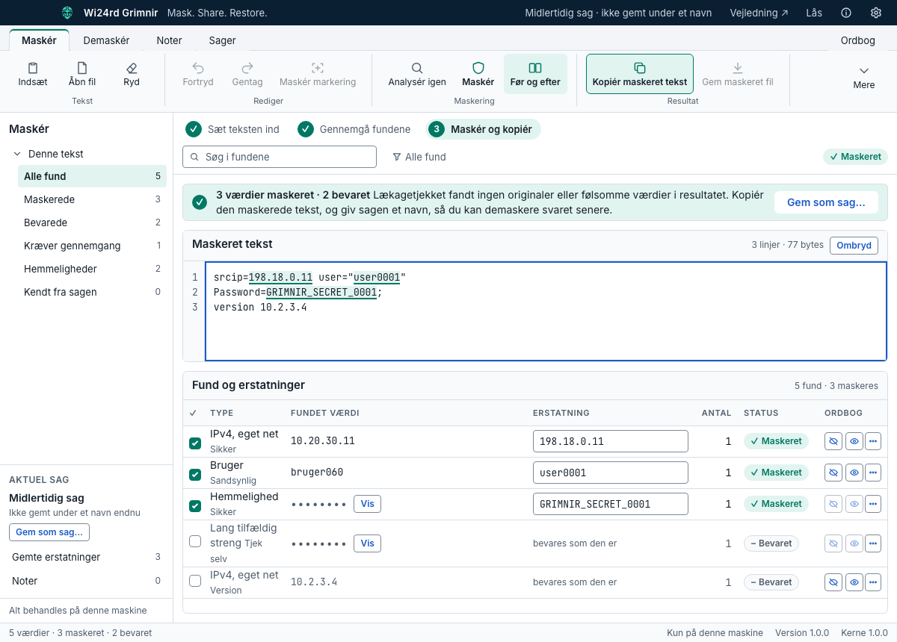

# Wi24rd Grimnir – brugervejledning

*Mask. Share. Restore.*

Grimnir er et program til din egen Mac. Det erstatter følsomme værdier i en log eller et script med neutrale koder, før du deler teksten med en leverandørs support eller en chatbot. Det kan være IP-adresser, maskinnavne, brugere og adgangskoder. Når svaret kommer tilbage, sætter Grimnir de rigtige værdier ind igen i stedet for koderne. Alt sker på din egen maskine.

Grimnir er til dig, der arbejder med it og jævnligt skal vise en log eller et script til nogen uden for huset, uden at vise dine net, maskiner, brugere og hemmeligheder.

> **Status:** version 1.0.0 til macOS (Apple silicon). Programmet er signeret med Developer ID og notariseret af Apple. Windows-udgaven er ikke bygget. Denne vejledning følger version 1.0.0.

## Sådan er vejledningen bygget op

| Kapitel | Læs det, når du … |
|---|---|
| [Før du starter](10-foer-du-starter.md) | vil vide, hvad Grimnir gør, ikke gør, og hvad den kræver |
| [Installation](20-installation.md) | skal have programmet på din Mac og vil kontrollere det, du har hentet |
| [Opsætning](30-opsaetning.md) | starter Grimnir første gang: låseskærmen, guiden og ordbogen |
| [Maskér](40-visninger/masker.md) | skal maskere en log eller et script |
| [Demaskér](40-visninger/demasker.md) | har fået et svar med koder og vil have de rigtige værdier tilbage |
| [Noter](40-visninger/noter.md) | vil skrive ned, hvem du har sendt loggen til, og hvad du venter på |
| [Sager](40-visninger/sager.md) | vil gemme, finde, omdøbe eller slette en sag |
| [Ordbog](40-visninger/ordbog.md) | vil lære Grimnir dine domæner, net og maskinnavne |
| [Indstillinger](50-indstillinger.md) | vil ændre tema, sprog, tekststørrelse, nye sager eller låsen |
| [Låsen](60-laasen.md) | vil forstå, hvornår Grimnir låser, og hvad låsen beskytter mod |
| [Data](70-data.md) | vil vide, hvor dine sager og din ordbog ligger, og hvordan du sletter dem |
| [Fejlfinding](80-fejlfinding.md) | ser en fejltekst i programmet |
| [Opdatering](85-opdatering.md) | vil have en nyere udgave |
| [Afinstallation](90-afinstallation.md) | vil fjerne Grimnir helt |
| [Tastaturgenveje](95-genveje.md) | vil styre programmet fra tastaturet |
| [Ordliste](99-ordliste.md) | støder på et ord, du ikke kender |

## Den korte udgave

1. Åbn Grimnir, og lås op med Touch ID eller din adgangskode.
2. Sæt loggen ind under **Maskér** med ⌘V. Grimnir viser de følsomme værdier som rækker, før noget bliver erstattet.
3. Se rækkerne igennem, særligt dem med status **Tjek selv**, og tryk **Maskér**.
4. Tryk **Kopiér maskeret tekst**, og sæt teksten ind i din mail eller chat.
5. Når svaret kommer, så sæt det ind under **Demaskér**, og tryk **Demaskér**. **Kopiér resultat** kopierer svaret med de rigtige værdier.

Det er sagen, der husker, hvilken kode der hører til hvilken værdi. Giv den et navn med **Gem som sag…**, så du let finder den igen, når svaret kommer. Se [Sager](40-visninger/sager.md).

*Efter **Maskér** står teksten med koder i stedet for værdierne, og **Kopiér maskeret tekst** er næste skridt.*

Læs altid den maskerede tekst, før du deler den. Grimnir finder værdier ud fra mønstre og din ordbog og kan overse en værdi.

## Licens

Grimnir er open source under Apache-2.0-licensen. Skrifterne er Inter og JetBrains Mono (SIL Open Font License 1.1). Tredjepartslicenserne står i programmet under **Om Grimnir** (se [Indstillinger](50-indstillinger.md)). Grimnir har ingen konto og ingen Wi24rd-server.
