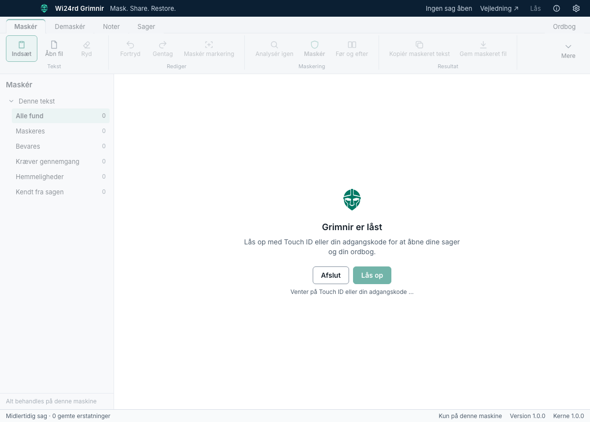
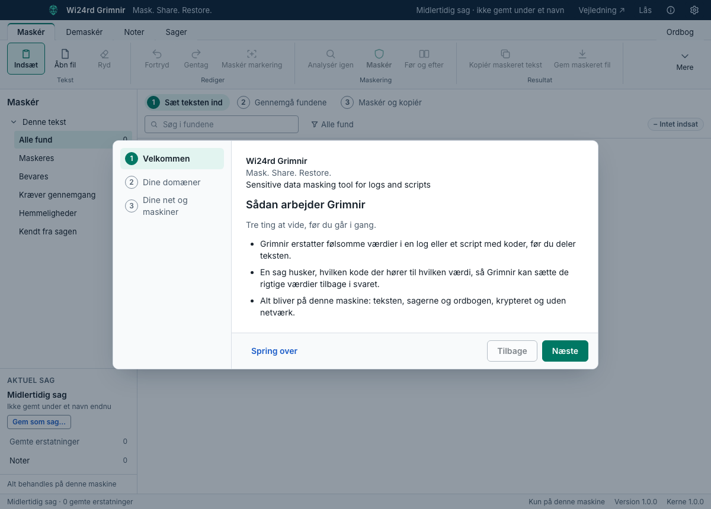
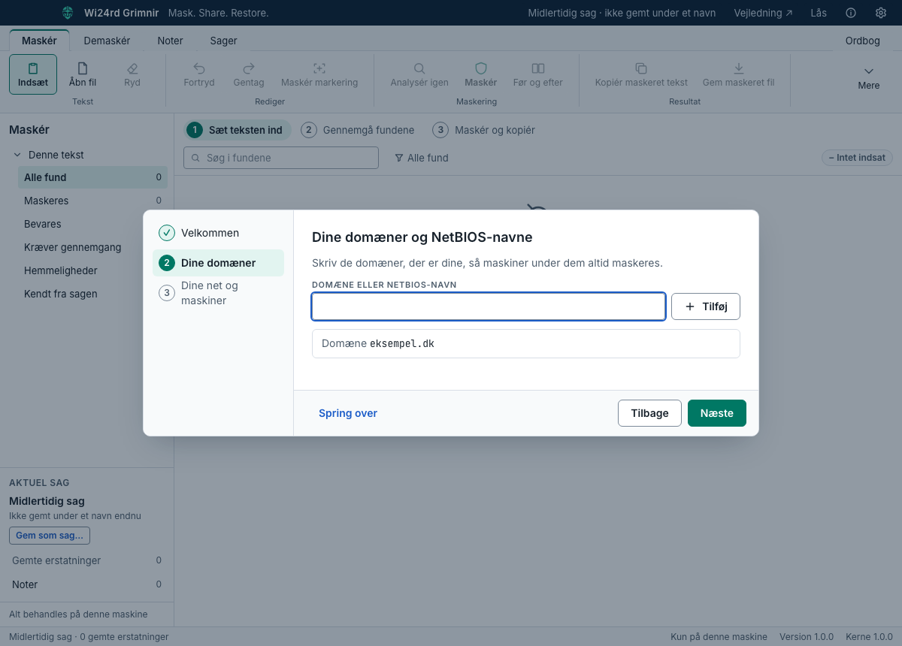
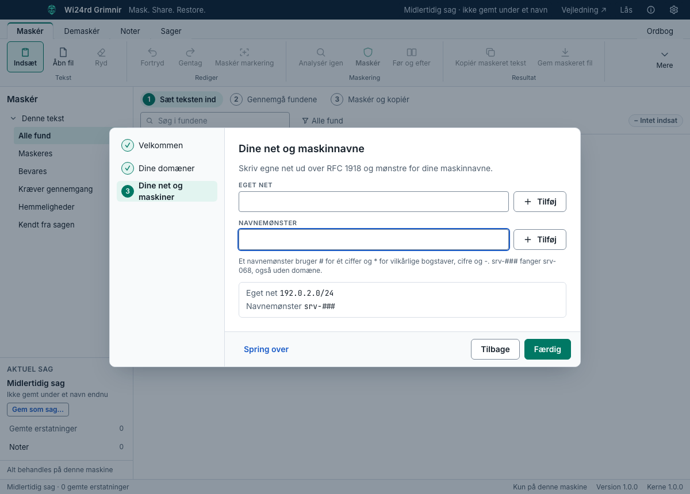

# Opsætning

Grimnir har ingen konto og intet at forbinde til. Opsætningen er tre ting: lås op, gennemgå guiden, og læg dine egne domæner, net og maskinnavne i ordbogen.

## 1. Lås op

Grimnir starter altid låst. macOS beder straks om Touch ID eller din adgangskode, og låseskærmen står bag dialogen, til du har svaret.

*Låseskærmen, mens macOS venter på dit svar. Fanerne og båndet er nedtonede, til Grimnir er låst op.*

- Svarer du med Touch ID eller din adgangskode, forsvinder låseskærmen, og dine sager og din ordbog hentes.
- Annullerer du, står der **Grimnir er stadig låst. Tryk Lås op for at prøve igen.** Tryk **Lås op** (eller Enter) for at prøve igen.
- **Afslut** lukker Grimnir.

Mere om låsen står i [Låsen](60-laasen.md).

## 2. Guiden

Første gang du har låst op, og din ordbog er tom, åbner en guide i tre trin. Du kan springe den over på alle trin med **Spring over** eller Esc. Når du har trykket **Færdig** eller **Spring over**, åbner den ikke af sig selv igen. Du åbner den igen under **Indstillinger** med **Vis guiden igen**.

### Trin 1: Velkommen

*Trin 1, **Sådan arbejder Grimnir**: tre ting at vide, før du går i gang.*

### Trin 2: Dine domæner

Skriv de domæner, der er dine, i feltet **Domæne eller NetBIOS-navn**, og tryk **Tilføj** (eller Enter). Maskiner under dine domæner maskeres altid. En værdi med punktum bliver et domæne, fx `eksempel.dk`. En værdi uden punktum bliver et NetBIOS-domæne, fx `KONTOR`.

*Trin 2 med `eksempel.dk` lagt i ordbogen. Listen under feltet viser det, der allerede står der.*

### Trin 3: Dine net og maskiner

- **Eget net**: et net i CIDR-form (adresse/præfiks), fx `192.0.2.0/24`, eller én adresse. De private net efter RFC 1918 er altid dine egne; her skriver du de andre.
- **Navnemønster**: formen på dine maskinnavne. `#` er ét ciffer, `*` er vilkårlige bogstaver, cifre og `-`. `srv-###` fanger `srv-068`, også uden domæne.

*Trin 3 med et eget net og et navnemønster. **Færdig** lukker guiden.*

Alt, du tilføjer i guiden, lægges straks i ordbogen. Du kan rette eller fjerne det bagefter under **Ordbog**.

## 3. Ordbogen

Ordbogen er det, Grimnir altid skal finde, uanset sag, og det, den aldrig må røre. Guiden lægger dine domæner, net og navnemønstre der. Ord, personer og værdier, der aldrig må maskeres, lægger du selv under **Ordbog**. Se [Ordbog](40-visninger/ordbog.md).

## Valg for nye sager

Under **Indstillinger** vælger du, om nye sager skal maskere offentlige adresser, om sidste oktet bevares i dine egne net, og hvor længe en ny sag gælder. Standarderne passer til de fleste. Se [Indstillinger](50-indstillinger.md).
