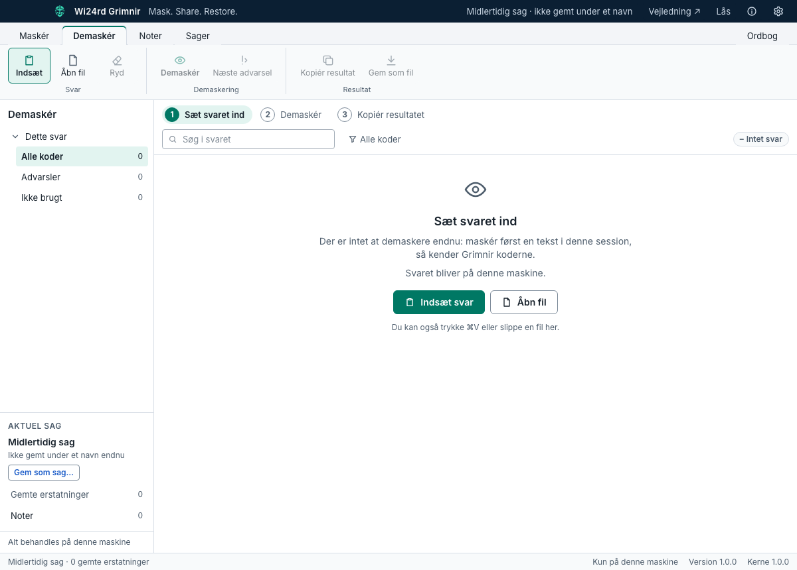
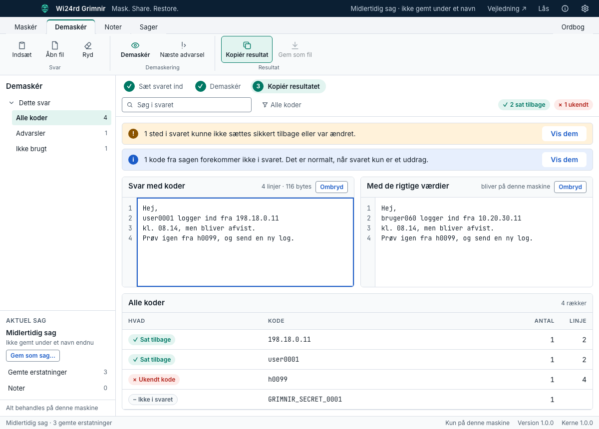
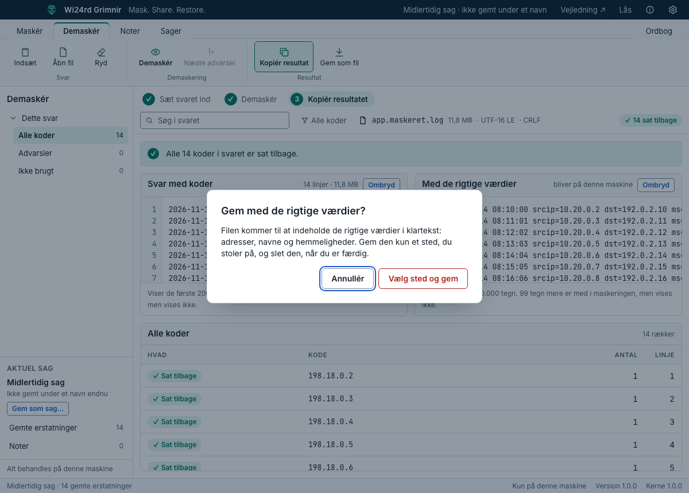

# Demaskér

Genvej: ⌘2

## Hvad viser den?

Demaskér er der, hvor du sætter svaret fra support eller en chatbot ind og får de rigtige værdier tilbage i stedet for koderne. Grimnir bruger koderne i den sag, der er åben. Øverst står de tre trin: **Sæt svaret ind**, **Demaskér** og **Kopiér resultatet**.

*Demaskér, før sagen har nogen koder: maskér først en tekst, så kender Grimnir koderne.*

## Sådan gør du

1. Kopiér svaret.
2. Tryk ⌘V i Demaskér, eller tryk **Indsæt svar**. Et svar kan være op til 8 MB; større filer åbner du med **Åbn fil**.
3. Tryk **Demaskér** (⌘↵).
4. Se advarslerne igennem (se nedenfor).
5. Tryk **Kopiér resultat** (⇧⌘C).

Hører svaret til en anden sag end den åbne, så åbn den sag først under **Sager** med **Åbn i Maskér**. Se [Sager](sager.md).

## Resultatet

*Svaret med koder til venstre, **Med de rigtige værdier** til højre. To koder er sat tilbage, én er ukendt, og én kode fra sagen står ikke i svaret.*

- **Svar med koder** er det, du satte ind.
- **Med de rigtige værdier** er svaret med dine værdier. Det bliver på denne maskine.
- Tabellen viser hver kode med **Hvad**, **Kode**, **Antal** og **Linje**.

Træet til venstre filtrerer tabellen: **Alle koder**, **Advarsler** og **Ikke brugt**. **Næste advarsel** (⌘G) springer til næste advarsel i svaret.

## Advarslerne

Et banner siger, hvor mange steder i svaret der ikke kunne sættes sikkert tilbage eller var ændret. **Vis dem** viser dem. Kolonnen **Hvad** siger, hvad der er sket:

| Hvad | Betyder |
|---|---|
| **Sat tilbage** | Koden er erstattet med den rigtige værdi. |
| **Ukendt kode** | Noget i svaret har en kodes form, men sagen kender det ikke. Det står urørt. |
| **Ukendt adresse i sagens net** | En adresse i et af sagens net, som sagen ikke kender. |
| **Andre store/små bogstaver** | Koden står med andre store og små bogstaver end i sagen. Den er sat tilbage. |
| **Maskine uden domæne** | Maskinen står alene, hvor originalen havde det fulde navn med domæne. Den er sat tilbage. |
| **Domæne alene** | Domænet står alene, hvor originalen kun havde det som en del af et navn. Det er sat tilbage. |
| **Escaped skråstreg** | Koden står escaped, som i JSON (`NB01\\user0001`). Den er sat tilbage. |
| **URL-kodet** | Koden står URL-kodet (fx `%40` eller `%5C`). Den er sat tilbage. |
| **Ikke i svaret** | En kode fra sagen står ikke i svaret. Det er normalt, når svaret kun er et uddrag. |
| **Ligner en anden sag** | Svaret har mange koder, sagen ikke kender. Måske hører det til en anden sag. |
| **Pulje løb over: …** | Der var ikke flere koder af en slags, så nogle koder er taget fra en reservepulje. |

Er alle koder i svaret sat tilbage, står der fx **Alle 3 koder i svaret er sat tilbage.**

## Kopiér og gem

- **Kopiér resultat** (⇧⌘C) kopierer svaret med de rigtige værdier. Grimnir skriver det selv til udklipsholderen med mærket for fortroligt indhold, så programmer, der husker udklipsholderens historik og følger det mærke, kan springe det over. Kan Grimnir ikke skrive mærket, kopieres teksten uden det. Står den stadig i udklipsholderen, når Grimnir låser eller afslutter, fjerner Grimnir den.
- **Gem som fil** findes, når du har åbnet svaret som fil. Grimnir spørger først, for filen kommer til at have de rigtige værdier i klartekst.

*Spørgsmålet, før en demaskeret fil gemmes. **Vælg sted og gem** åbner systemets Gem-dialog.*

Gem kun filen et sted, du stoler på, og slet den, når du er færdig. Grimnir ved ikke, hvor den ligger, og sletter den ikke.

## Ryd

**Ryd** fjerner svaret og resultatet. Er resultatet hverken kopieret eller gemt, spørger Grimnir først. Sagen røres ikke.

## Klik videre

- **Vis dem** i et banner filtrerer tabellen på advarslerne eller på kodene, der ikke blev brugt.
- Et filter i træet viser kun de rækker.
- **Åbn Sager** står i den tomme visning, når du skal åbne den sag, svaret hører til.
