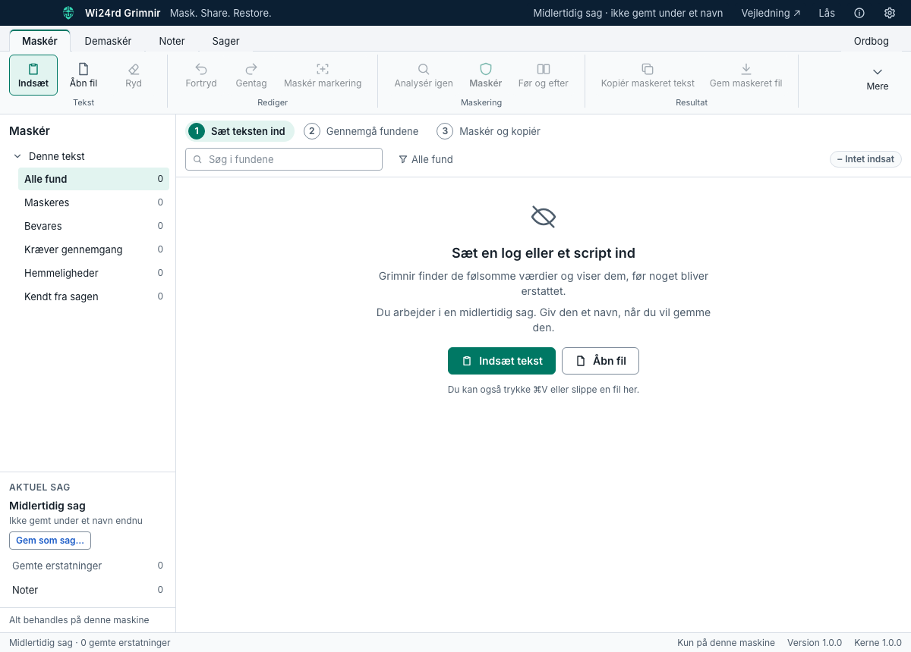
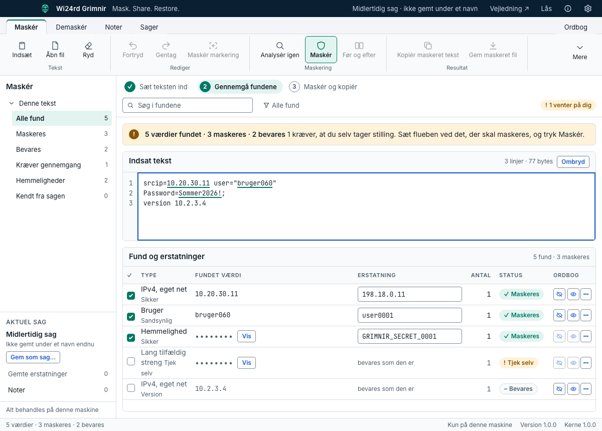
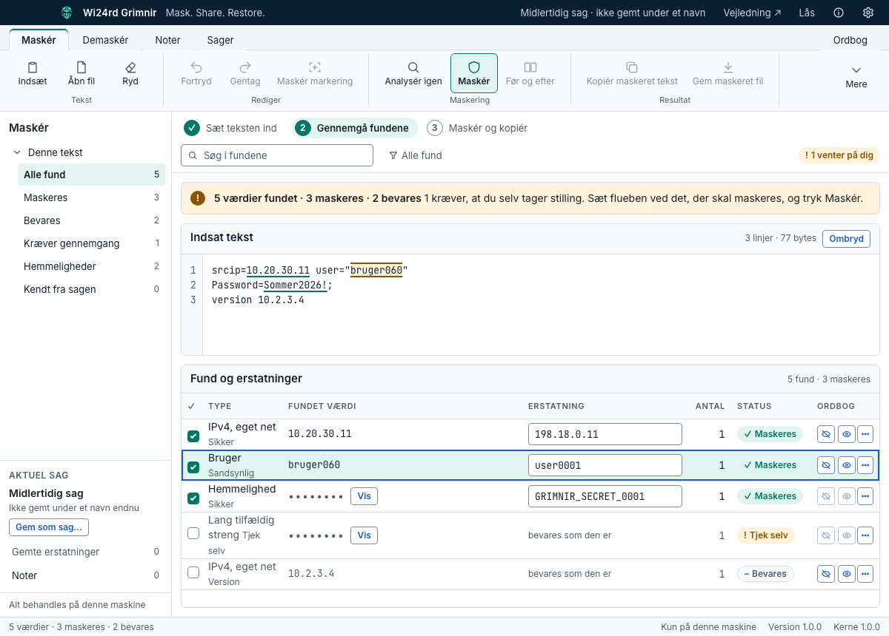
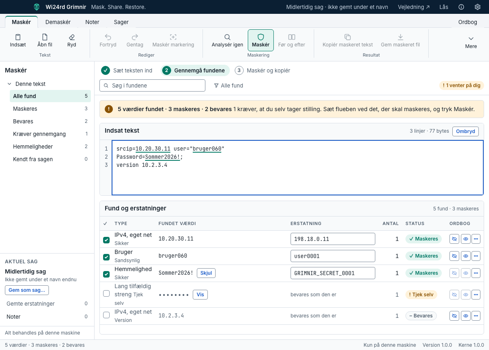
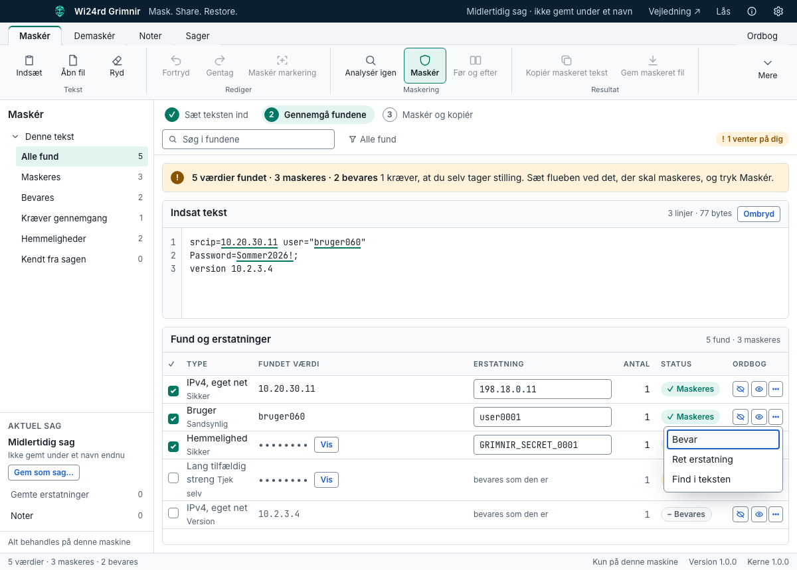
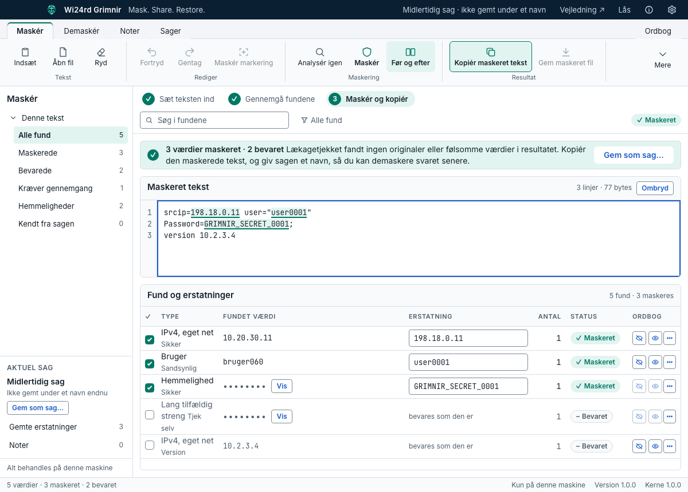
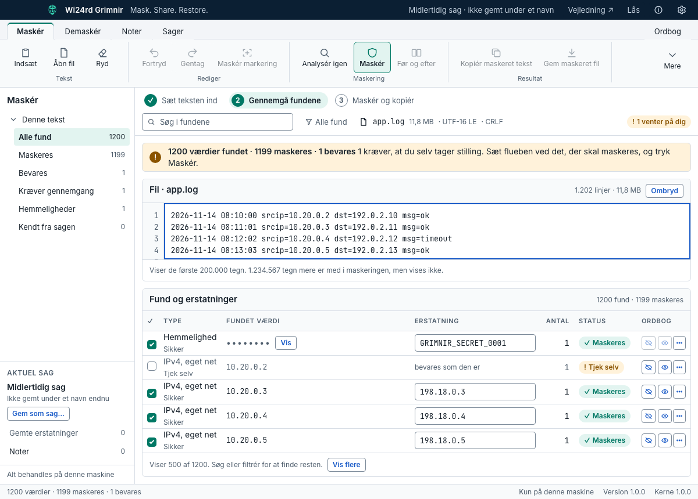
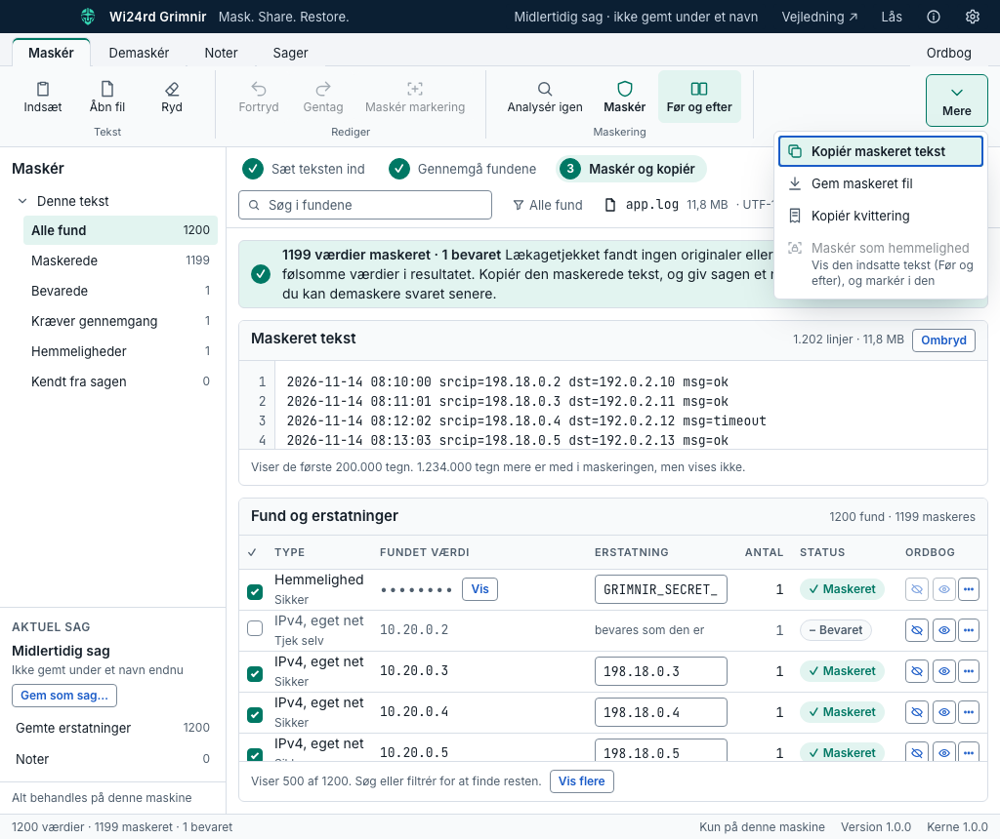
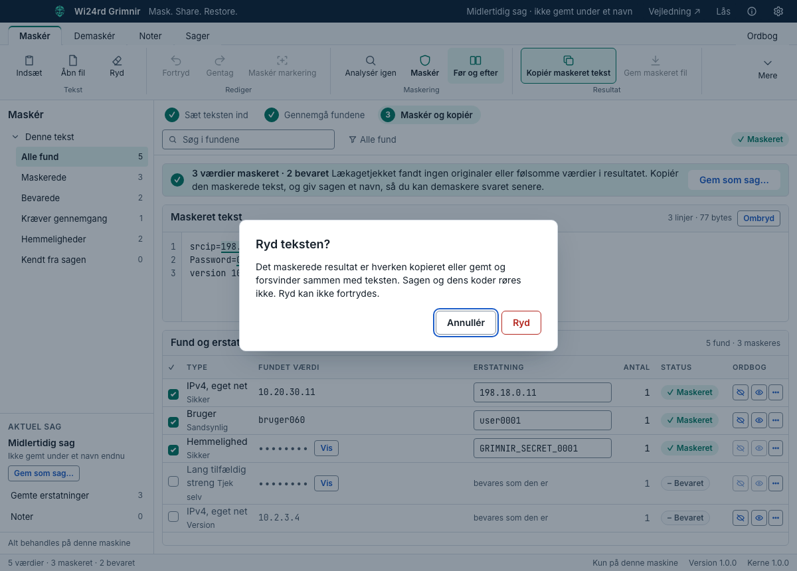
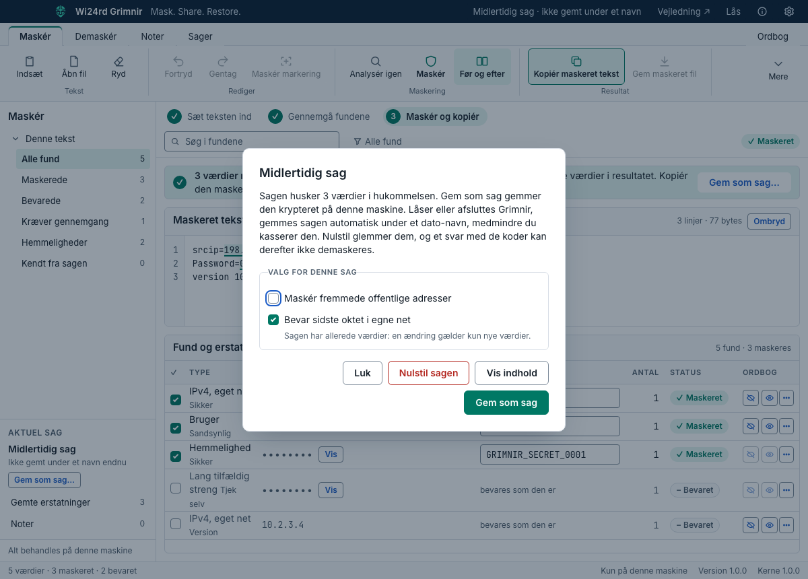

# Maskér

Genvej: ⌘1

## Hvad viser den?

Maskér er der, hvor du sætter en log eller et script ind, ser, hvad Grimnir fandt, og erstatter værdierne med koder. Øverst står de tre trin: **Sæt teksten ind**, **Gennemgå fundene** og **Maskér og kopiér**. Trinnet, du er ved, er fremhævet.

*Maskér, før der er sat noget ind. **Indsæt tekst** og **Åbn fil** står midt i vinduet, og ⌘V virker også.*

## Sådan gør du

1. Kopiér loggen eller scriptet fra det sted, den står.
2. Tryk ⌘V i Maskér, eller tryk **Indsæt tekst**. Grimnir analyserer teksten med det samme.
3. Se fundene igennem i tabellen **Fund og erstatninger**. Sæt flueben ved det, der skal maskeres, og fjern fluebenet ved det, der skal bevares.
4. Tryk **Maskér** (⌘↵).
5. Læs den maskerede tekst, og tryk **Kopiér maskeret tekst** (⇧⌘C).
6. Sæt teksten ind i din mail eller chat.

En indsat tekst kan være op til 5 MB. Større filer åbner du med **Åbn fil** (se nedenfor).

## Fundene

*Den indsatte tekst med linjenumre og de fundne værdier understreget. Banneret siger, hvor mange værdier der blev fundet, og hvor mange der kræver, at du selv tager stilling.*

Hver række i tabellen er én værdi, uanset hvor mange steder den står. Kolonnerne:

| Kolonne | Betyder |
|---|---|
| **✓** | Flueben: værdien maskeres. Uden flueben bevares den, som den er. |
| **Type** | Hvad Grimnir mener, værdien er, fx **IPv4, eget net**, **Bruger** eller **Hemmelighed**. Under typen står, hvor sikker Grimnir er: **Sikker**, **Fra ordbog**, **Sandsynlig**, **Tjek selv** eller **Version**. |
| **Fundet værdi** | Værdien, som den står i teksten. En hemmelighed står som prikker. |
| **Erstatning** | Koden, værdien får. Du kan rette den i feltet. |
| **Antal** | Hvor mange steder værdien står i teksten. |
| **Status** | **Maskeres** eller **Bevares** (efter maskeringen **Maskeret** eller **Bevaret**). |
| **Ordbog** | Læg værdien i ordbogen som **Maskér altid** eller **Maskér aldrig**, og rækkens **…**-menu. |

Rækker mærket **Tjek selv** er dem, Grimnir ikke er sikker på, og **Version** er en værdi, der står som et versionsnummer. Ingen af dem har flueben fra start. Se dem altid igennem.

Offentlige adresser står også som rækker, men får kun flueben fra start, hvis **Maskér fremmede offentlige adresser** er slået til for sagen (se [Indstillinger](../50-indstillinger.md)).

Træet til venstre filtrerer tabellen: **Alle fund**, **Maskeres**, **Bevares**, **Kræver gennemgang**, **Hemmeligheder** og **Kendt fra sagen** (værdier, sagen kendte i forvejen og giver samme kode som sidst). Feltet **Søg i fundene** søger i koder og værdier.

*Et klik på en række markerer værdien alle steder i den indsatte tekst.*

## Hemmeligheder

En hemmelighed, fx en adgangskode, står som prikker i tabellen. **Vis** viser værdien i rækken, og **Skjul** skjuler den igen. Værdien sendes først til vinduet, når du vælger **Vis**, og søgningen finder ikke en skjult hemmelighed på dens værdi. Hemmeligheder kan ikke lægges i ordbogen.

*Efter **Vis** står hemmeligheden i rækken, og knappen hedder **Skjul**. Den indsatte tekst øverst står, som du satte den ind; kun tabellen skjuler værdien.*

## Rækkens "…"-menu

*Menuen **…** på en række: **Bevar** (eller **Maskér**), **Ret erstatning** og **Find i teksten**.*

- **Maskér** og **Bevar** gør det samme som fluebenet.
- **Ret erstatning** lader dig rette koden i feltet **Erstatning**. En erstatning, der allerede findes i sagen eller i teksten, kan ikke bruges.
- **Find i teksten** viser, hvor værdien står.
- **Fjern** står på en værdi, du selv har tilføjet med **Maskér markering**.

## En værdi, Grimnir ikke fandt

1. Markér værdien i den indsatte tekst, med musen eller Skift + piletaster (⌥ tager et ord ad gangen).
2. Vælg **Maskér markering** (⇧⌘M) i båndet eller i menuen, du får ved højreklik. Er det en hemmelighed, så vælg **Maskér som hemmelighed**.

Alle steder, hvor værdien står som et helt ord, tages med. Et bogstav eller et ciffer lige før eller efter gør den til en del af et længere ord, og dér tages den ikke med. I en åben fil markerer du i den viste tekst (de første 200.000 tegn); rækken gælder hele filen.

**Fortryd** (⌘Z) og **Gentag** (⇧⌘Z) virker på dine valg: flueben, erstatninger, typer og tilføjede værdier. Historikken tømmes ved **Maskér**, en ny tekst og **Ryd**.

## Efter maskeringen

*Den maskerede tekst står med koderne markeret. Banneret har lækagetjekkets svar, og trin 3 er aktuelt.*

- **Kopiér maskeret tekst** (⇧⌘C) kopierer den maskerede tekst. Den kan kopieres op til 5 MB; et større resultat gemmer du som fil.
- **Gem maskeret fil** (⌘S) gemmer resultatet som en ny fil. Den findes, når du har åbnet en fil; en indsat tekst kopieres i stedet.
- **Kopiér kvittering** kopierer en kort tekst med tallene fra maskeringen: hvor mange værdier af hver type der blev maskeret. Den har ingen original værdi og intet filnavn, kun sagens navn.
- **Før og efter** viser den indsatte tekst igen, så du kan markere i den.

**Lækagetjekket** ser efter maskeringen resultatet igennem. Finder det en original eller noget, der stadig ligner en følsom værdi, siger banneret det, og **Vis dem** viser stederne.

Ændrer du et valg efter maskeringen, står der **Valgene er ændret. Tryk Maskér igen for at få et nyt resultat.**

## Åbn en fil

Tryk **Åbn fil** (⌘O), eller slip filen på vinduet.

- Filen kan være op til 100 MB, i UTF-8 med eller uden BOM eller i UTF-16 med BOM.
- Vinduet viser de første 200.000 tegn. Analysen og maskeringen gælder hele filen.
- Tabellen viser 500 rækker ad gangen. **Vis flere** viser flere; søg eller filtrér for at finde resten.
- Grimnir åbner filen kun til læsning og skriver aldrig til den. **Gem maskeret fil** skriver en ny fil, og den må ikke hedde det samme som den, teksten kom fra.
- Én fil ad gangen. Mapper og zip-filer kan ikke åbnes.

*En åben fil: navnet, størrelsen og tegnsættet står over teksten, og tabellen viser de første 500 af 1200 fund.*

## Et smalt vindue

Er vinduet smalt, flytter de sidste kommandoer i båndet ind under **Mere**. Er næste skridt en af dem, er **Mere** fremhævet, og kommandoen er fremhævet i menuen. Hvilke kommandoer der flytter, afhænger af vinduets bredde, sproget og tekststørrelsen.

*Et smalt vindue efter maskeringen: her står **Kopiér maskeret tekst** under **Mere** og er fremhævet som næste skridt.*

## Ryd

**Ryd** fjerner teksten, fundene og dine valg. Er resultatet hverken kopieret eller gemt, spørger Grimnir først. Sagen og dens koder røres ikke.

*Spørgsmålet **Ryd teksten?** kommer, når der er noget, der ville gå tabt. Ryd kan ikke fortrydes.*

## Sagen i titellinjen

En maskering hører altid til en sag. Har du ikke valgt en, er det den midlertidige sag. Titellinjen viser **Midlertidig sag · ikke gemt under et navn**, og et klik åbner sagens dialog.

*Den midlertidige sags dialog. **Valg for denne sag** gælder kun nye værdier, når sagen allerede har værdier.*

- **Gem som sag** giver sagen et navn og gemmer den krypteret.
- **Nulstil sagen** glemmer sagens værdier. Et svar med de koder kan derefter ikke demaskeres.
- **Vis indhold** viser sagens koder og værdier (se [Sager](sager.md)).

Låser eller afsluttes Grimnir, gemmes en midlertidig sag med værdier automatisk under et navn med dato og klokkeslæt, medmindre du kasserer den. Se [Låsen](../60-laasen.md).

## Klik videre

- Et klik på en række markerer værdien i teksten. **Find i teksten** i rækkens menu gør det samme.
- Et klik på et filter i træet viser kun de rækker.
- **Vis dem** i et banner viser de rækker eller steder, banneret taler om.
- **Gemte erstatninger** under **Aktuel sag** til venstre viser sagens indhold.
