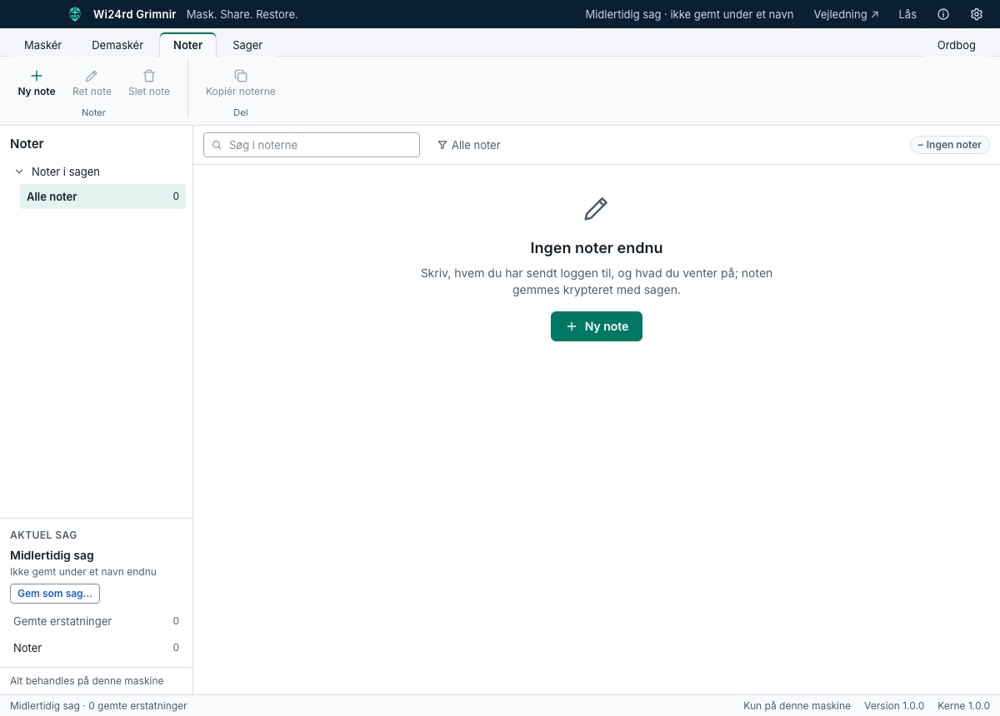
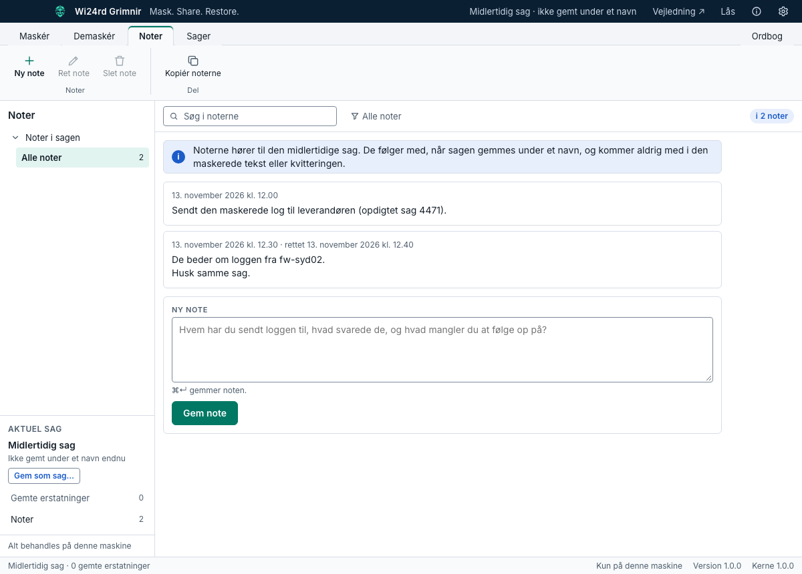
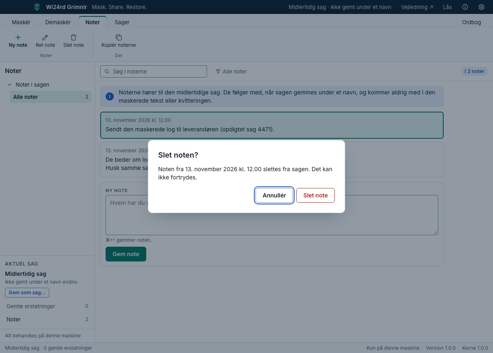

# Noter

Genvej: ⌘3

## Hvad viser den?

Noter er dine egne noter til den åbne sag, også den midlertidige: hvem du har sendt loggen til, hvad de svarede, og hvad du mangler at følge op på. Hver note har dato og klokkeslæt for, hvornår den er skrevet, og hvornår den sidst er rettet.

*Noter, før sagen har nogen. **Ny note** i båndet begynder en.*

## Sådan gør du

1. Tryk **Ny note**. Markøren står i feltet.
2. Skriv noten.
3. Tryk **Gem note** eller ⌘↵. Under en rettelse hedder knappen **Gem**.

Vælg en note i listen for at rette eller slette den. **Ret note** åbner den i feltet; Esc annullerer rettelsen. **Slet note** spørger først.

*To noter i den midlertidige sag. Den nederste er rettet, og det står ved den.*

- En note kan være på højst 4.000 tegn, og en sag kan have højst 200 noter.
- **Kopiér noterne** kopierer alle sagens noter med sagens navn og tidspunkterne. Står de stadig i udklipsholderen, når Grimnir låser eller lukker, fjerner Grimnir dem.
- **Søg i noterne** finder noter med et ord.

*Spørgsmålet, før en note slettes. Det kan ikke fortrydes.*

## Hvad sker der med noterne?

- Noterne gemmes krypteret sammen med sagen. De kommer aldrig med i den maskerede tekst eller kvitteringen.
- Grimnir gennemsøger ikke noterne for værdier og maskerer dem ikke. Skriv derfor ikke noget i en note, du ikke vil have stående i sagen.
- Noter i den midlertidige sag følger med, når sagen gemmes under et navn. Kasserer du den midlertidige sag, går noterne tabt.

## Klik videre

- **Noter** under **Aktuel sag** til venstre åbner fanen Noter med antallet af noter.
- I **Sager** viser kolonnen **Noter**, hvor mange noter hver sag har.
