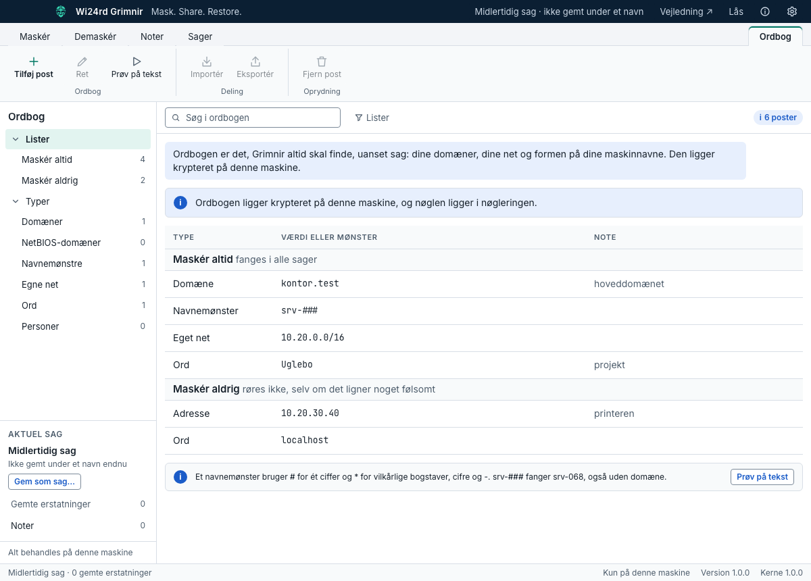
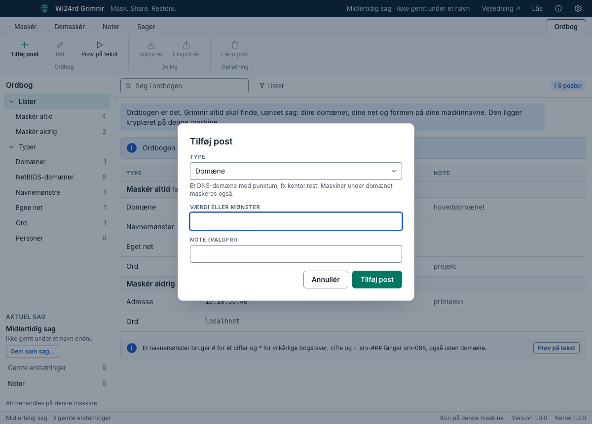
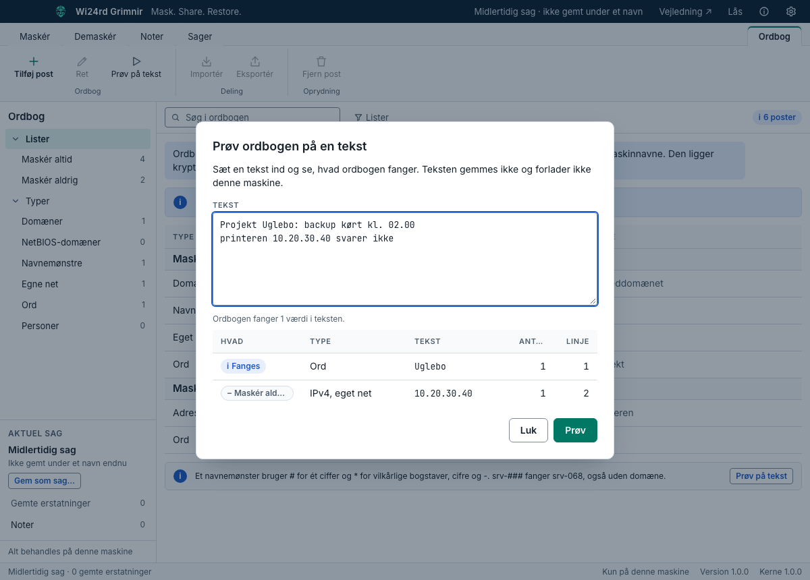
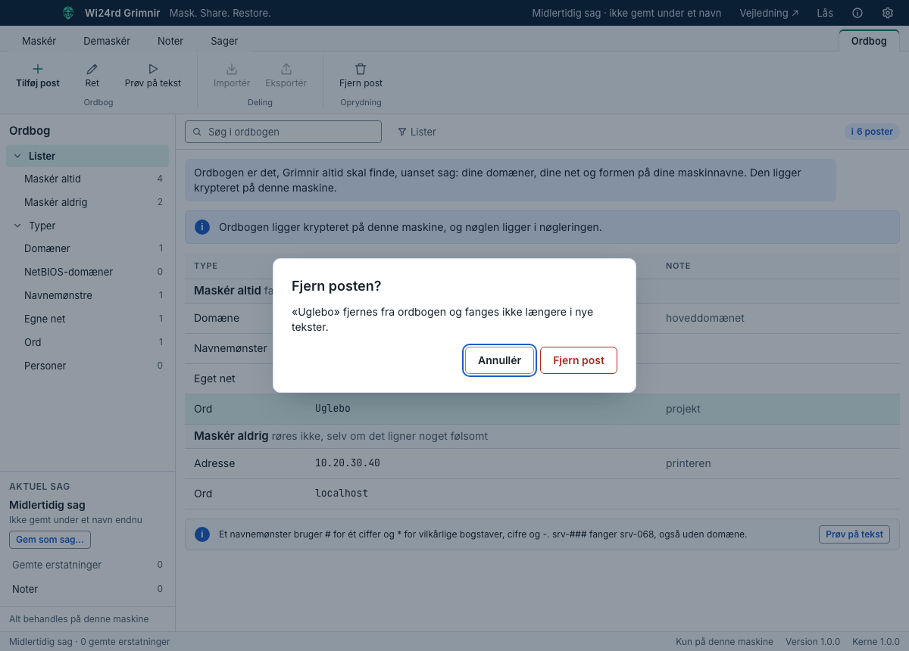

# Ordbog

Genvej: ⌘5

## Hvad viser den?

Ordbogen er det, Grimnir altid skal finde, uanset sag: dine domæner, dine net og formen på dine maskinnavne. Den er også det, Grimnir aldrig må røre. Ordbogen gælder i alle sager og ligger krypteret på din Mac med sin nøgle i nøgleringen.

*De to lister med type, værdi eller mønster og en note. Træet til venstre filtrerer på liste og type.*

Ordbogen har to lister:

- **Maskér altid** (fanges i alle sager).
- **Maskér aldrig** (røres ikke, selv om det ligner noget følsomt). En værdi på **Maskér aldrig** vinder over alt andet.

## Typerne

| Type | Hvad du skriver |
|---|---|
| **Domæne** | Et DNS-domæne med punktum, fx `kontor.test`. Maskiner under domænet maskeres også. |
| **NetBIOS-domæne** | Et NetBIOS-domæne uden punktum, fx `KONTOR` (højst 15 tegn). |
| **Navnemønster** | `#` er ét ciffer, `*` er vilkårlige bogstaver, cifre og `-`. `srv-###` fanger `srv-068`, også uden domæne. |
| **Eget net** | Et net i CIDR-form (adresse/præfiks) eller én adresse. De private net efter RFC 1918 er altid dine egne; her skriver du de andre. Højst /8. |
| **Ord** | Et ord, der altid maskeres, fx et projekt- eller kundenavn (mindst to tegn). |
| **Person** | Et personnavn, der altid maskeres. |
| **Maskér aldrig** | En værdi, der aldrig maskeres: en adresse, et net, et domæne eller et ord. |

Hemmeligheder kan ikke lægges i ordbogen. Ligner en værdi en adgangskode, siger Grimnir det.

## Sådan gør du

### Tilføj en post

1. Tryk **Tilføj post**.
2. Vælg **Type**, og skriv **Værdi eller mønster**.
3. Skriv eventuelt en **Note (valgfri)**, fx hvad værdien er (højst 200 tegn).
4. Tryk **Tilføj post** i dialogen.

*Tilføj post. Hjælpeteksten under feltet skifter med typen.*

### Fra Maskér

I fundtabellen under **Maskér** har hver række to knapper i kolonnen **Ordbog**: **Altid** (Maskér altid: læg værdien i ordbogen) og **Aldrig** (Maskér aldrig: læg værdien i ordbogen). Har flere maskinnavne i en tekst samme form, foreslår Grimnir mønsteret i et banner med **Læg i ordbogen** og **Ikke nu**.

### Prøv ordbogen på en tekst

Tryk **Prøv på tekst**, sæt en tekst ind, og tryk **Prøv**. Grimnir viser, hvad ordbogen fanger. Teksten gemmes ikke og forlader ikke denne maskine.

*Prøv på tekst: ordet fra ordbogen står som **Fanges**, adressen fra **Maskér aldrig** står som **Maskér aldrig**.*

### Ret eller fjern en post

Vælg posten, og tryk **Ret** eller **Fjern post**. En fjernet post fanges ikke længere i nye tekster.

*Fjern posten? Posten fjernes fra ordbogen og fanges ikke længere i nye tekster.*

**Importér** og **Eksportér** er nedtonede: de kommer i en senere version af Grimnir.

## Klik videre

- Et punkt i træet (**Maskér altid**, **Maskér aldrig** eller en type) viser kun de poster.
- **Søg i ordbogen** søger i posterne.
- **Prøv på tekst** står også i banneret under listen.
