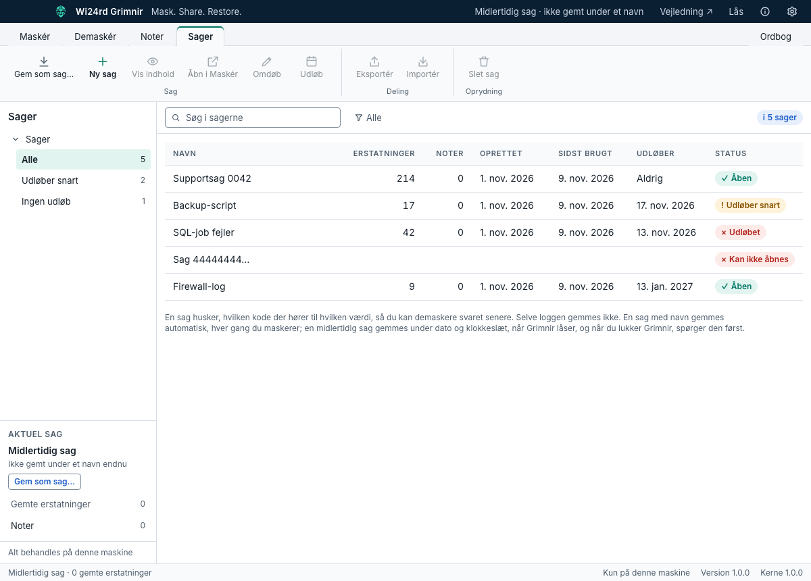
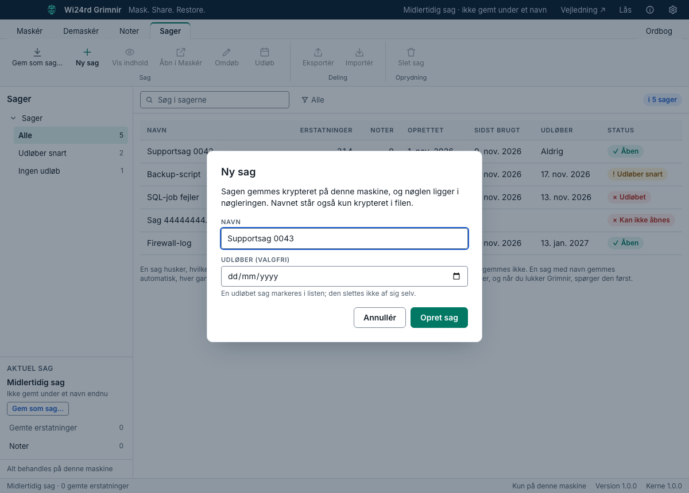
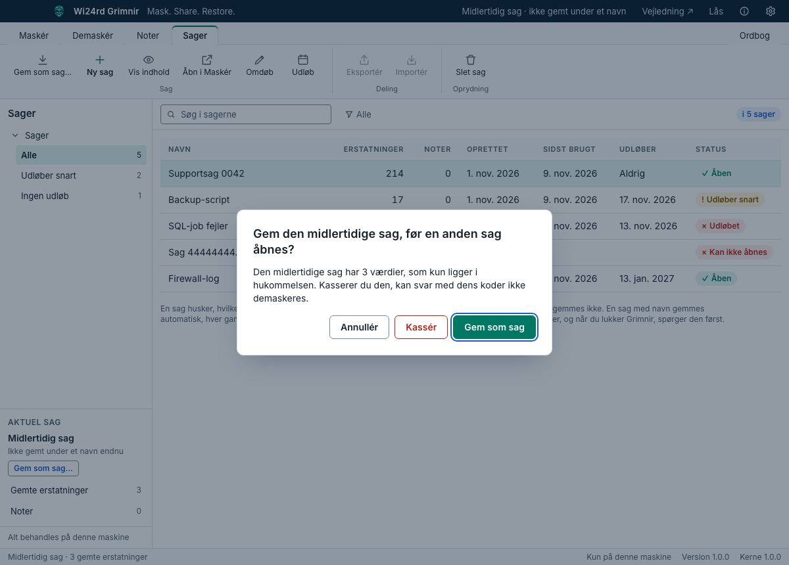
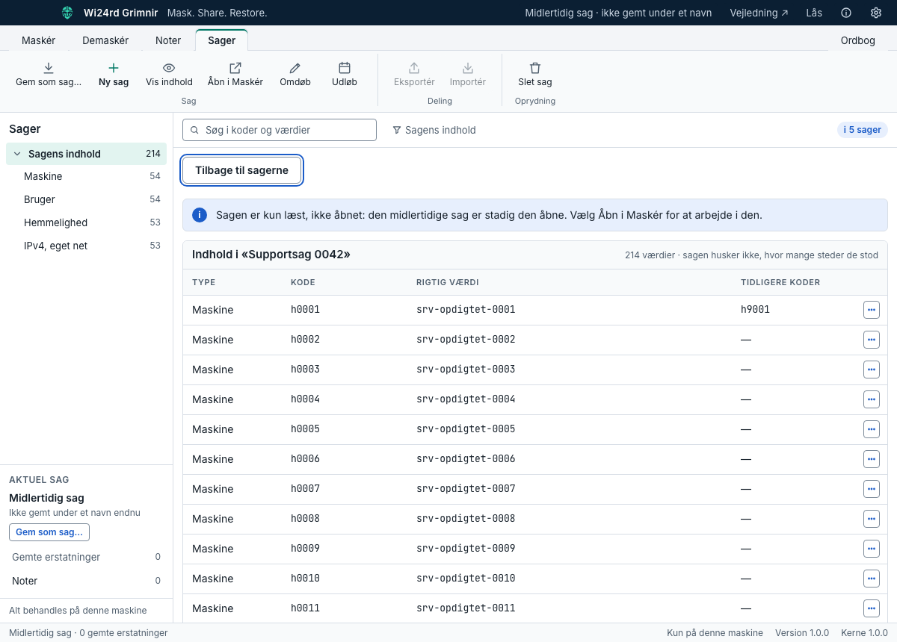
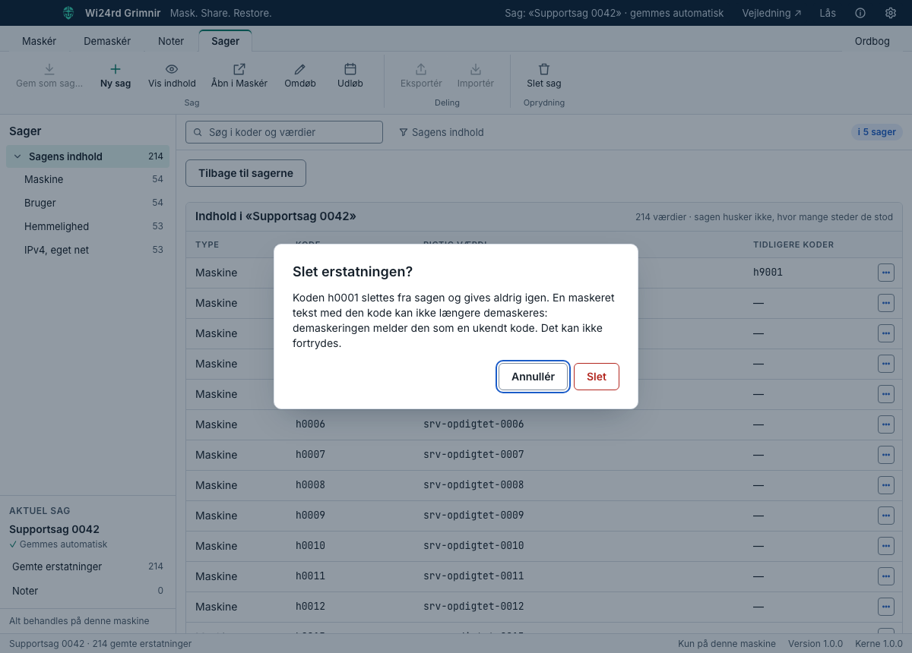
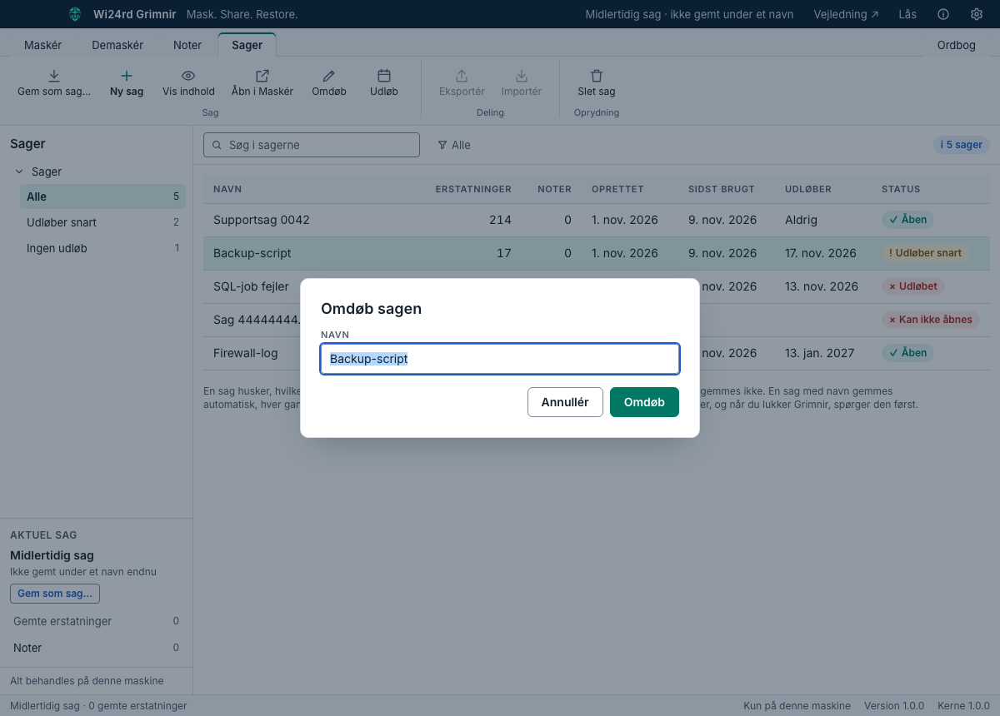
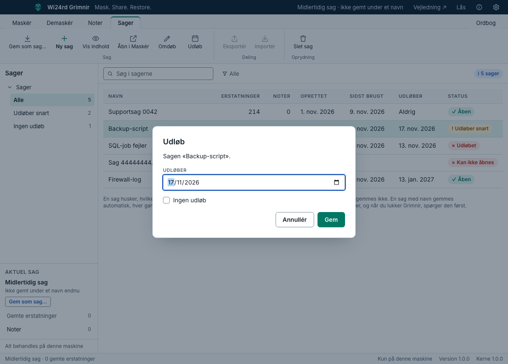
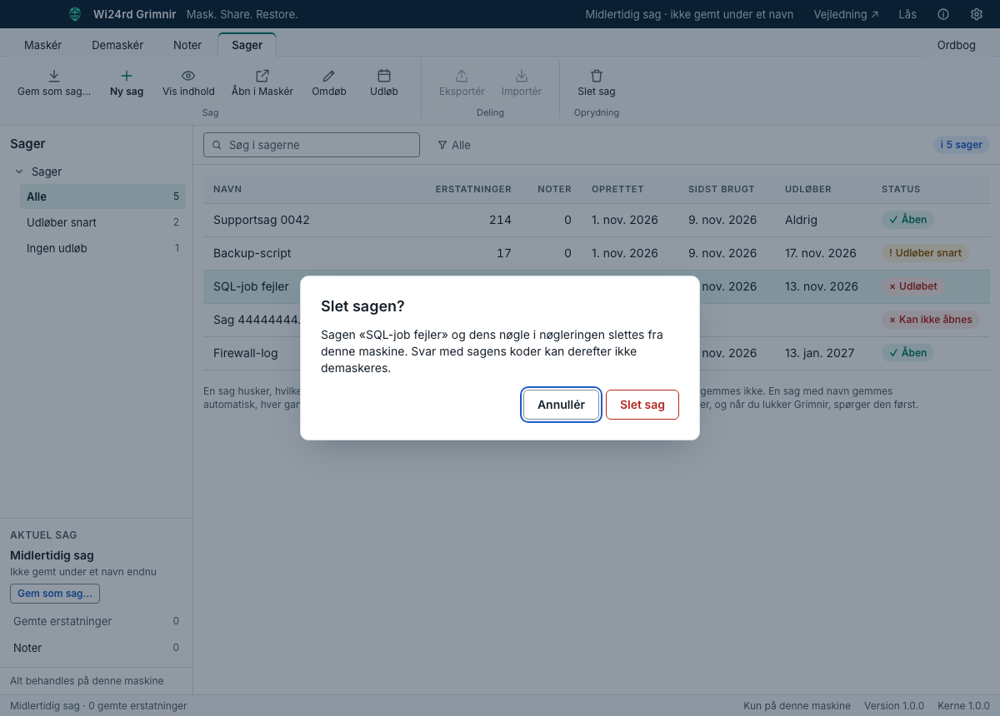

# Sager

Genvej: ⌘4

## Hvad viser den?

En sag husker, hvilken kode der hører til hvilken værdi, så du kan demaskere svaret senere. Selve loggen gemmes ikke. Hver sag er én krypteret fil på din Mac med sin egen nøgle i nøgleringen. Sager viser listen over dine gemte sager.

*Fem sager: to er åbne, én udløber snart, én er udløbet, og én kan ikke åbnes.*

| Kolonne | Betyder |
|---|---|
| **Navn** | Sagens navn. En sag, der ikke kan åbnes, hedder **Sag** og begyndelsen af dens id, fordi navnet kun står krypteret i filen. |
| **Erstatninger** | Hvor mange værdier sagen husker. |
| **Noter** | Hvor mange noter sagen har. |
| **Oprettet** og **Sidst brugt** | Datoerne. |
| **Udløber** | Sagens udløb, eller **Aldrig**. |
| **Status** | **Åben**, **Udløber snart** (inden for 7 dage), **Udløbet** eller **Kan ikke åbnes**. Står musen over en sag, der ikke kan åbnes, siger værktøjstippet hvorfor. |

Træet til venstre filtrerer: **Alle**, **Udløber snart** (også de udløbne) og **Ingen udløb**. **Søg i sagerne** søger i navnene.

## Den midlertidige sag og navngivne sager

- **Den midlertidige sag** er den, du arbejder i, når du ikke har valgt en sag. Den ligger kun i hukommelsen. Låser eller afsluttes Grimnir, gemmes den automatisk som en navngiven sag med dato og klokkeslæt som navn, hvis den har værdier. Lukker du Grimnir selv, spørger Grimnir først.
- **En navngiven sag** gemmes automatisk, hver gang du maskerer.

## Sådan gør du

### Gem den midlertidige sag under et navn

Tryk **Gem som sag…** (i båndet, under **Aktuel sag** til venstre eller i sagens dialog i titellinjen). Skriv et navn, vælg eventuelt et udløb, og tryk **Opret sag**. Den midlertidige sag med sine værdier og noter bliver den nye sag.

### Opret en ny sag

*Ny sag. **Udløber (valgfri)** foreslår standardudløbet fra Indstillinger.*

Tryk **Ny sag**. Navnet skal være 1–120 tegn uden linjeskift. Er en navngiven sag åben, lukkes den (den er gemt), og den nye sag starter tom.

### Åbn en sag

Vælg sagen, og tryk **Åbn i Maskér**. Så maskerer og demaskerer du med den sags koder. Har den midlertidige sag værdier, spørger Grimnir først:

*Tre svar: **Annullér**, **Kassér** og **Gem som sag**. Kasserer du, kan svar med den midlertidige sags koder ikke demaskeres.*

Den åbne sag står i titellinjen som **Sag: «navn» · gemmes automatisk**. Et klik åbner sagens dialog med **Luk sag**, der lukker sagen her; filen bliver.

### Se sagens indhold

Tryk **Vis indhold**, tryk Enter, eller dobbeltklik på sagen. Indholdet viser hver værdi med **Type**, **Kode**, **Rigtig værdi** og **Tidligere koder**. Sagen husker ikke, hvor mange steder værdierne stod.

*Sagens indhold, kun læst: banneret siger, at den åbne sag stadig er den midlertidige. **Tilbage til sagerne** (eller Esc) går tilbage til listen.*

Rækkens **…**-menu har **Kopiér værdi** og **Slet**:

- **Kopiér værdi** kopierer den rigtige værdi. Grimnir skriver den selv til udklipsholderen med mærket for fortroligt indhold og fjerner den ved lås og afslutning, hvis den stadig står der. En hemmelighed går aldrig gennem vinduet.
- **Slet** sletter en erstatning fra sagen. Det kan kun gøres i den åbne sag; åbn den i Maskér først.

*Den slettede kode gives aldrig igen. En maskeret tekst med den kode kan ikke længere demaskeres. Det kan ikke fortrydes.*

### Omdøb

*Omdøb sagen. Navnet står kun krypteret i filen.*

### Sæt et udløb

*Udløb for en sag. Vælg en dato, eller sæt flueben ved **Ingen udløb**.*

En udløbet sag markeres i listen; den slettes ikke af sig selv, og koderne kan stadig demaskeres.

### Slet en sag

*Slet sagen? **Annullér** har fokus.*

**Slet sag** sletter sagens fil og dens nøgle i nøgleringen fra din Mac. Svar med sagens koder kan derefter ikke demaskeres.

**Eksportér** og **Importér** er nedtonede: de kommer i en senere version af Grimnir.

## Klik videre

- Enter eller dobbeltklik på en sag viser dens indhold.
- Et filter i træet viser kun de sager.
- **Gemte erstatninger** under **Aktuel sag** til venstre viser den åbne sags indhold.
