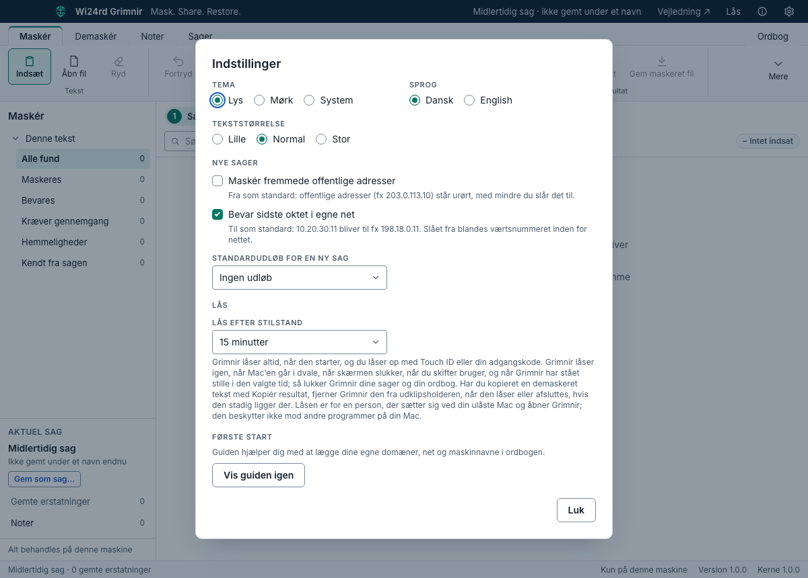
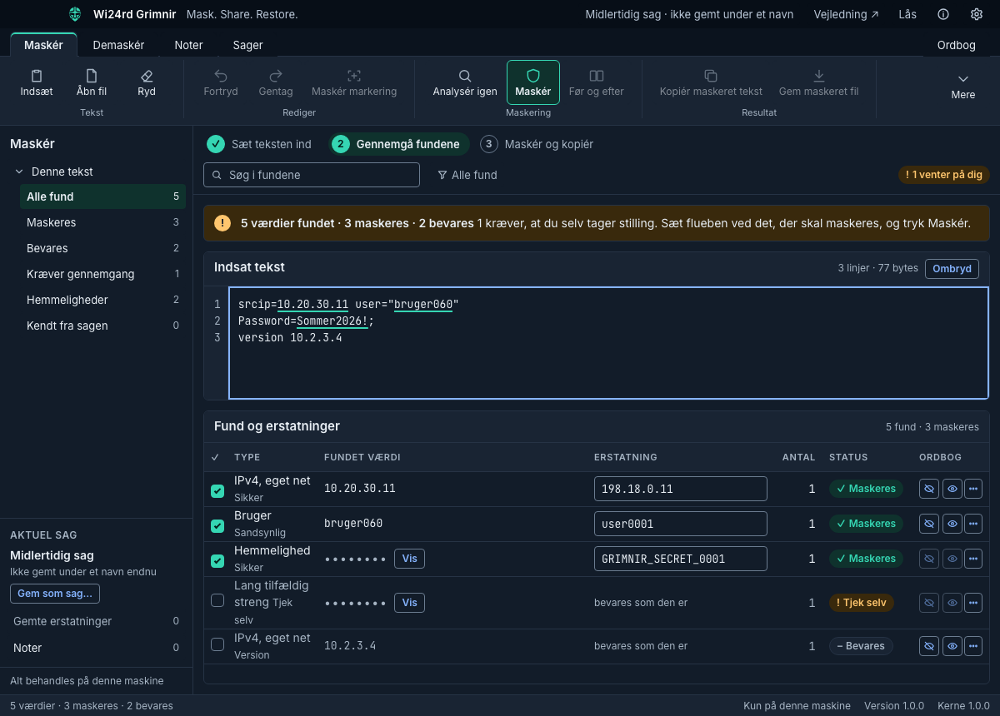
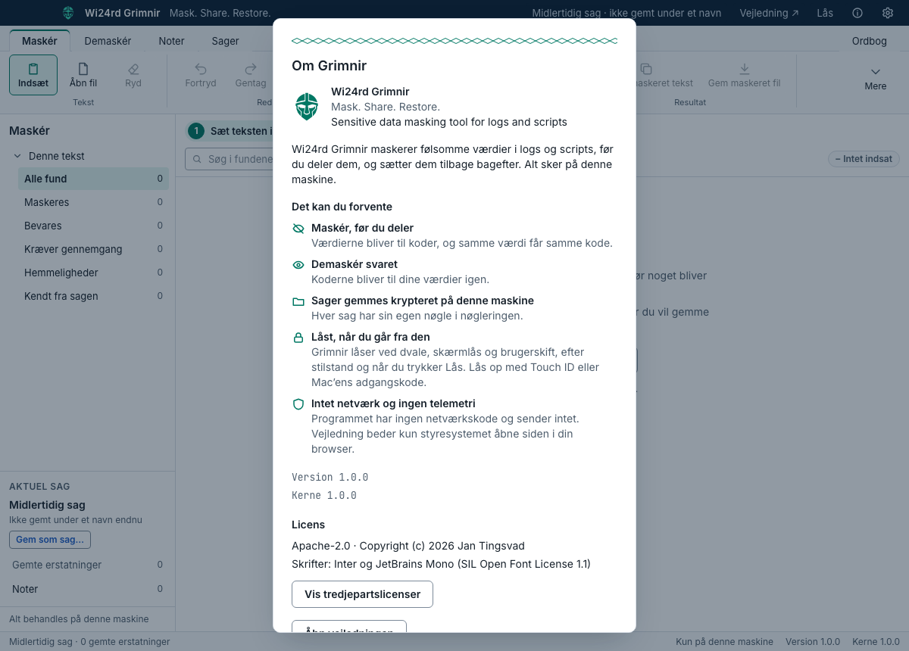

# Indstillinger

Åbn **Indstillinger** med tandhjulet øverst til højre, med ⌘, eller i menuen **Grimnir** → **Indstillinger…**. Et valg gemmes, så snart du ændrer det. **Luk** lukker dialogen. Indstillingerne virker også, mens Grimnir er låst; kun **Vis guiden igen** er nedtonet.

*Alle indstillinger i én dialog. Under hvert valg står, hvad det gør.*

## Tema, sprog og tekststørrelse

| Felt | Valg | Standard | Virkning |
|---|---|---|---|
| **Tema** | **Lys**, **Mørk**, **System** | **System** | Farverne i hele vinduet. **System** følger macOS. |
| **Sprog** | **Dansk**, **English** | **Dansk** | Sproget i vinduet. Skifter med det samme. |
| **Tekststørrelse** | **Lille**, **Normal**, **Stor** | **Normal** | Størrelsen på al tekst i vinduet. ⌘+, ⌘− og ⌘0 og menuen **Vis** gør det samme. |

*Maskér i temaet **Mørk**.*

## Nye sager

Valgene gælder for nye sager. En sag, der allerede findes, har sine egne valg i sagens dialog i titellinjen (**Valg for denne sag**).

| Felt | Valg | Standard | Virkning |
|---|---|---|---|
| **Maskér fremmede offentlige adresser** | til eller fra | fra | Fra: offentlige adresser (fx 203.0.113.10) står urørt, med mindre du slår det til. |
| **Bevar sidste oktet i egne net** | til eller fra | til | Til: 10.20.30.11 bliver til fx 198.18.0.11. Slået fra blandes værtsnummeret inden for nettet. |
| **Standardudløb for en ny sag** | **Ingen udløb**, **30 dage**, **90 dage** | **Ingen udløb** | Udløbet, **Ny sag** foreslår. Det gælder også en midlertidig sag, der gemmes ved lås eller afslutning. |

## Lås

| Felt | Valg | Standard | Virkning |
|---|---|---|---|
| **Lås efter stilstand** | **5 minutter**, **15 minutter**, **30 minutter**, **60 minutter** | **15 minutter** | Grimnir låser, når den har stået stille i den tid: ingen tastatur eller mus i vinduet og intet arbejde i gang. Der er ingen indstilling, der slår låsen fra. |

Hvornår Grimnir ellers låser, og hvad der sker ved lås, står i [Låsen](60-laasen.md).

## Første start

**Vis guiden igen** åbner guiden fra første start, så du kan lægge flere domæner, net og maskinnavne i ordbogen. Se [Opsætning](30-opsaetning.md).

## Om Grimnir

**Om Grimnir** åbner du med ⓘ øverst til højre eller i menuen **Grimnir** → **Om Grimnir**.

*Om Grimnir: hvad du kan forvente af programmet, versionen af programmet og af kernen, licensen og skrifterne.*

- **Version** og **Kerne** er programmets og maskeringskernens versioner. De står også nederst til højre i vinduet.
- **Vis tredjepartslicenser** viser licenserne for de komponenter, Grimnir er bygget med.
- **Åbn vejledningen** beder styresystemet åbne denne vejledning i din browser.
