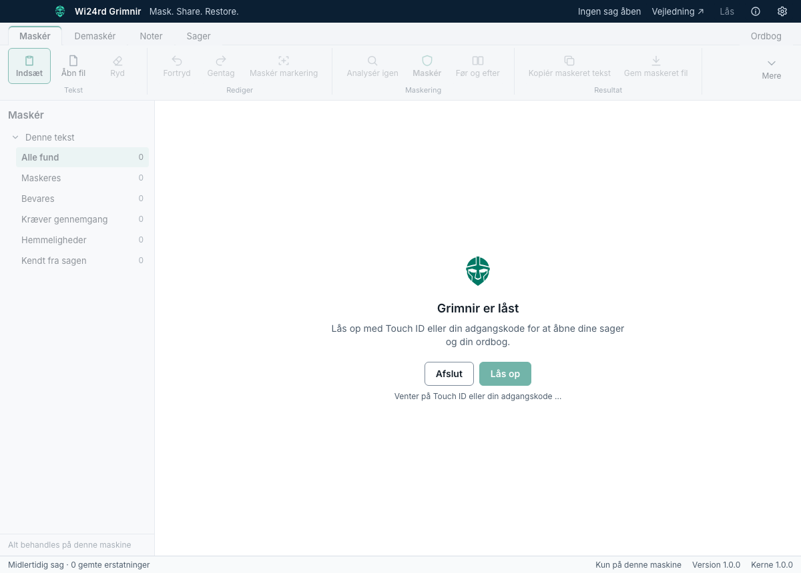

# Låsen

Grimnir sender ingen notifikationer. Den har intet ikon i menulinjen, kører ikke i baggrunden og starter ikke ved login. Det, der ligner en baggrundsfunktion, er låsen: den holder øje med, hvornår du går fra Mac'en.

## Låseskærmen

*Låseskærmen, mens macOS beder om Touch ID eller adgangskoden. Fanerne, båndet og den aktuelle sag er nedtonede.*

- **Lås op** (eller Enter) beder macOS om Touch ID. Adgangskoden er reserve.
- **Afslut** lukker Grimnir.
- Mens Grimnir er låst, står intet fra dine sager eller din ordbog i vinduet. **Indstillinger**, **Om Grimnir** og **Vejledning** virker stadig.

## Hvornår Grimnir låser

Grimnir låser altid, når den starter. Den låser igen:

- når Mac'en går i dvale,
- når skærmen slukker,
- når du skifter bruger,
- når Grimnir har stået stille i den tid, du har valgt under **Lås efter stilstand** (5, 15, 30 eller 60 minutter; standard 15),
- når du trykker **Lås** i titellinjen.

Låsen kan ikke slås fra. Efter en ny lås spørger Grimnir ikke om Touch ID af sig selv. Låseskærmen siger **Grimnir låste, mens du var væk. Tryk Lås op for at fortsætte.**

## Hvad der sker, når Grimnir låser

1. **Udklipsholderen:** det, Grimnir selv har kopieret med **Kopiér resultat**, **Kopiér noterne** eller **Kopiér værdi**, fjernes, hvis det stadig står i udklipsholderen. Har noget andet skrevet til udklipsholderen siden, røres den ikke. Maskeret tekst og andre programmers indhold røres aldrig.
2. **Teksterne:** den indsatte tekst, svaret, resultaterne og en åben fil forsvinder fra Grimnir.
3. **Sagen:** en navngiven sag, der er ændret, gemmes. En midlertidig sag med værdier gemmes som en navngiven sag med dato og klokkeslæt som navn og med standardudløbet fra **Indstillinger**.
4. **Ordbogen** lukkes og læses igen, når du har låst op.

Når du har låst op, siger et banner, hvad der skete, fx **Den midlertidige sag blev gemt som «…».** Den gemte sag åbner ikke af sig selv; du finder den under **Sager**.

## Når du afslutter

Afslutter du Grimnir med ⌘Q, med **Afslut Grimnir** i menuen eller ved at lukke vinduet, mens den midlertidige sag har værdier, spørger Grimnir først: **Gem den midlertidige sag, før Grimnir lukker?** Svarene er **Annullér**, **Kassér** og **Gem som sag**.

Afsluttes Grimnir ad en vej, der ikke spørger (Afslut fra Dock, log ud, genstart eller sluk), gemmes den midlertidige sag som ved lås, og navnet står i et banner efter næste oplåsning. Udklipsholderen ryddes ved afslutning på samme måde som ved lås.

Tvinges Grimnir til at slutte, går den ned, eller går strømmen, når Grimnir ikke at gemme eller rydde noget.

## Når Touch ID ikke lykkes

| Linje på låseskærmen | Betyder |
|---|---|
| **Grimnir er stadig låst. Tryk Lås op for at prøve igen.** | Du annullerede. Tryk **Lås op**. |
| **Det lykkedes ikke at bekræfte, at det er dig. Grimnir er stadig låst.** | macOS kunne ikke bekræfte dig. Tryk **Lås op** og prøv igen. |
| **Styresystemet kunne ikke bekræfte, hvem du er (fejl …). Grimnir er stadig låst.** | macOS svarede med en fejlkode. Prøv igen; se [Fejlfinding](80-fejlfinding.md). |
| **Grimnir kunne ikke spørge om oplåsning. Grimnir er stadig låst.** | Grimnir fik intet svar. Afslut, og start Grimnir igen. |

Har din brugerkonto ingen adgangskode, kan Mac'en ikke bekræfte, hvem du er. Så låser Grimnir op uden spørgsmål, og et banner siger **Denne maskine kan ikke bekræfte, hvem du er. Grimnir er ikke låst.**

## Hvad låsen ikke beskytter mod

Låsen er for en person, der sætter sig ved din ulåste Mac og åbner Grimnir. Den beskytter ikke mod andre programmer på din Mac, og den beskytter ikke en fil, du har gemt fra **Demaskér**. Lås din Mac, når du går fra den.
