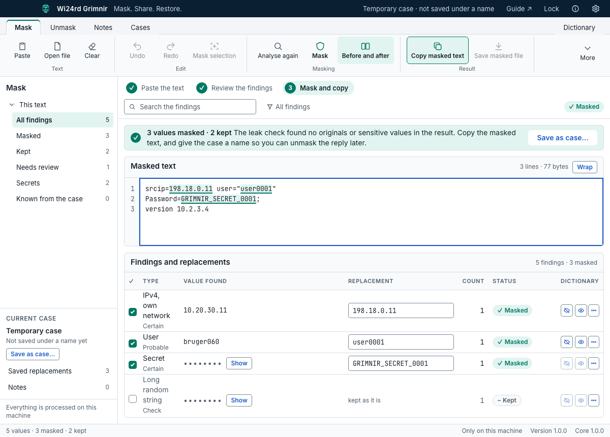

# Wi24rd Grimnir – user guide

*Mask. Share. Restore.*

Grimnir is a program for your own Mac. It replaces sensitive values in a log or a script with neutral codes before you share the text with a vendor's support or a chatbot. These can be IP addresses, machine names, users and passwords. When the reply comes back, Grimnir puts the real values back in place of the codes. Everything happens on your own machine.

Grimnir is for you who work in IT and regularly need to show a log or a script to someone outside the organisation, without showing your networks, machines, users and secrets.

> **Status:** version 1.0.0 for macOS (Apple silicon). The program is signed with Developer ID and notarised by Apple. The Windows version has not been built. This guide follows version 1.0.0.

## How the guide is organised

| Chapter | Read it when you … |
|---|---|
| [Before you start](10-foer-du-starter.md) | want to know what Grimnir does, does not do, and what it needs |
| [Installation](20-installation.md) | need the program on your Mac and want to check what you downloaded |
| [Setup](30-opsaetning.md) | start Grimnir for the first time: the lock screen, the guide and the dictionary |
| [Mask](40-visninger/masker.md) | need to mask a log or a script |
| [Unmask](40-visninger/demasker.md) | have a reply with codes and want the real values back |
| [Notes](40-visninger/noter.md) | want to write down who you sent the log to and what you are waiting for |
| [Cases](40-visninger/sager.md) | want to save, find, rename or delete a case |
| [Dictionary](40-visninger/ordbog.md) | want to teach Grimnir your domains, networks and machine names |
| [Settings](50-indstillinger.md) | want to change theme, language, text size, new cases or the lock |
| [The lock](60-laasen.md) | want to understand when Grimnir locks and what the lock protects against |
| [Data](70-data.md) | want to know where your cases and your dictionary are, and how to delete them |
| [Troubleshooting](80-fejlfinding.md) | see an error text in the program |
| [Updating](85-opdatering.md) | want a newer version |
| [Uninstalling](90-afinstallation.md) | want to remove Grimnir completely |
| [Keyboard shortcuts](95-genveje.md) | want to drive the program from the keyboard |
| [Glossary](99-ordliste.md) | meet a word you do not know |

## The short version

1. Open Grimnir, and unlock with Touch ID or your password.
2. Paste the log under **Mask** with ⌘V. Grimnir shows the sensitive values as rows before anything is replaced.
3. Go through the rows, especially those with the status **Check yourself**, and press **Mask**.
4. Press **Copy masked text**, and paste the text into your email or chat.
5. When the reply comes, paste it under **Unmask**, and press **Unmask**. **Copy result** copies the reply with the real values.

It is the case that remembers which code belongs to which value. Give it a name with **Save as case…**, so you can easily find it again when the reply comes. See [Cases](40-visninger/sager.md).

*After **Mask** the text shows codes instead of the values, and **Copy masked text** is the next step.*

Always read the masked text before you share it. Grimnir finds values from patterns and your dictionary and can miss a value.

## Licence

Grimnir is open source under the Apache-2.0 licence. The fonts are Inter and JetBrains Mono (SIL Open Font License 1.1). The third-party licences are in the program under **About Grimnir** (see [Settings](50-indstillinger.md)). Grimnir has no account and no Wi24rd server.
