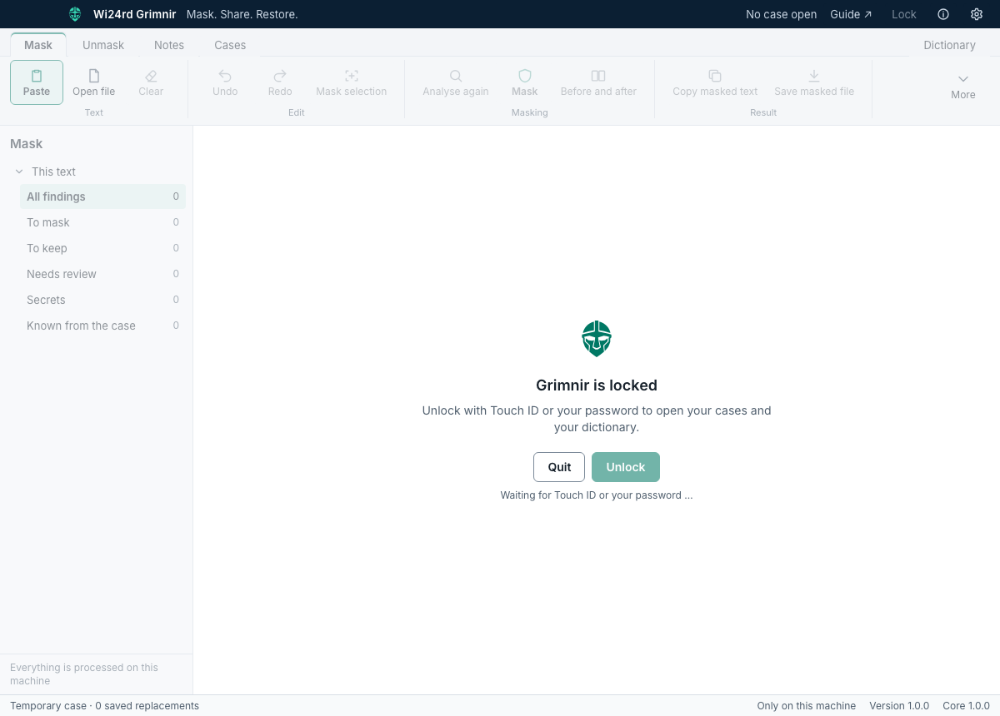
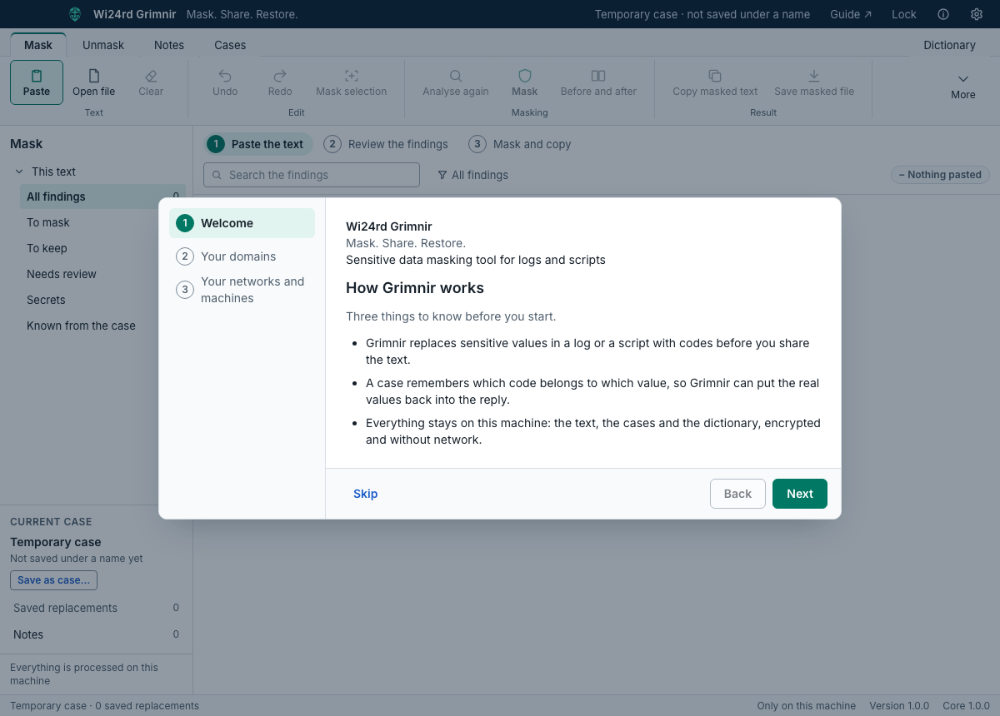
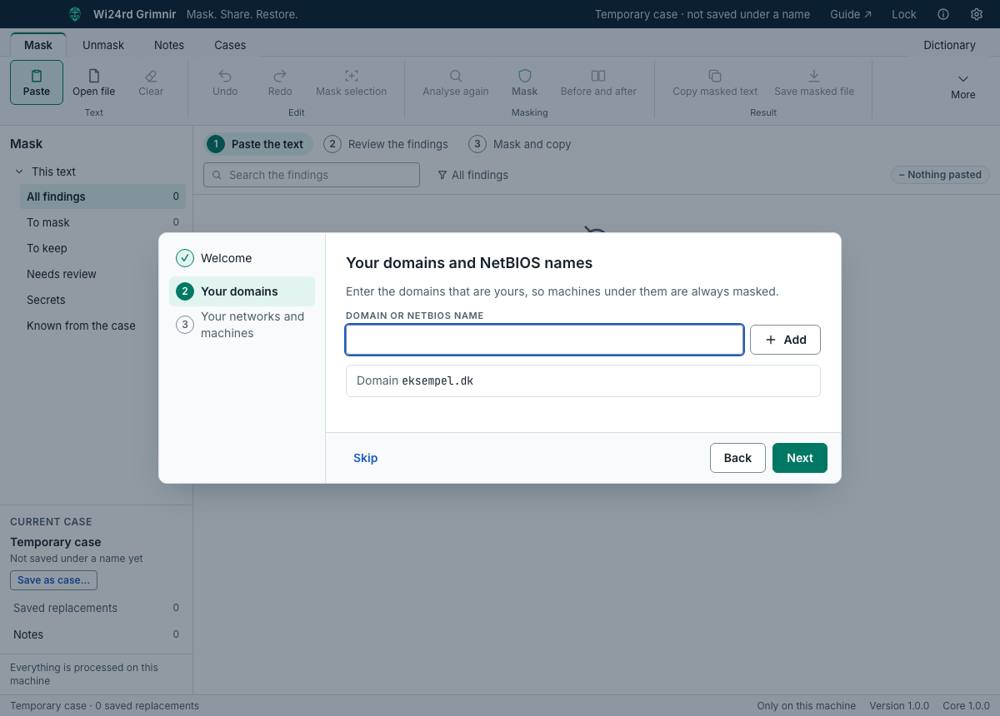
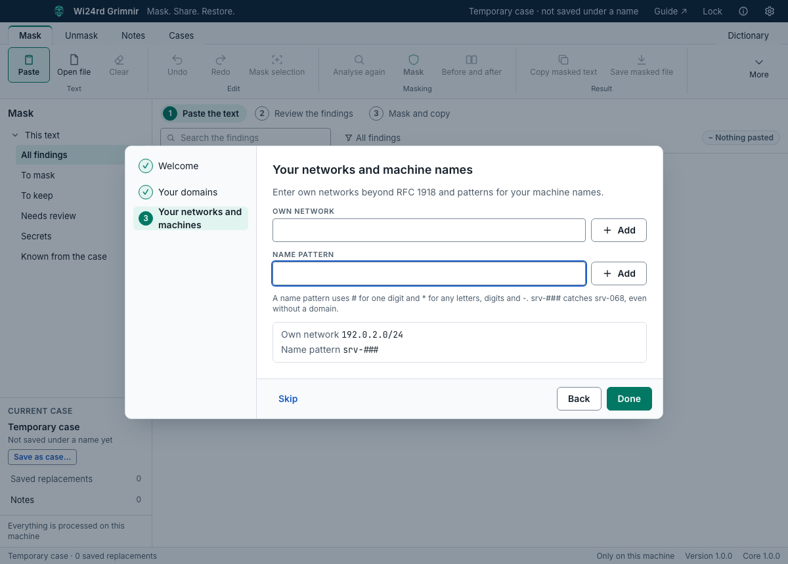

# Setup

Grimnir has no account and nothing to connect to. Setup is three things: unlock, go through the guide, and add your own domains, networks and machine names to the dictionary.

## 1. Unlock

Grimnir always starts locked. macOS asks for Touch ID or your password straight away, and the lock screen stays behind the dialog until you have answered.

*The lock screen while macOS waits for your answer. The tabs and the command bar are dimmed until Grimnir is unlocked.*

- If you answer with Touch ID or your password, the lock screen disappears, and your cases and your dictionary are loaded.
- If you cancel, it says **Grimnir is still locked. Press Unlock to try again.** Press **Unlock** (or Enter) to try again.
- **Quit** closes Grimnir.

More about the lock is in [The lock](60-laasen.md).

## 2. The guide

The first time you have unlocked, and your dictionary is empty, a guide in three steps opens. You can skip it at every step with **Skip** or Esc. When you have pressed **Done** or **Skip**, it does not open by itself again. You open it again under **Settings** with **Show the guide again**.

### Step 1: Welcome

*Step 1, **How Grimnir works**: three things to know before you start.*

### Step 2: Your domains

Enter the domains that are yours in the field **Domain or NetBIOS name**, and press **Add** (or Enter). Machines under your domains are always masked. A value with a dot becomes a domain, e.g. `eksempel.dk`. A value without a dot becomes a NetBIOS domain, e.g. `KONTOR`.

*Step 2 with `eksempel.dk` added to the dictionary. The list under the field shows what is already there.*

### Step 3: Your networks and machines

- **Own network**: a network in CIDR form (address/prefix), e.g. `192.0.2.0/24`, or one address. The private networks under RFC 1918 are always your own; here you enter the others.
- **Name pattern**: the form of your machine names. `#` is one digit, `*` is any letters, digits and `-`. `srv-###` catches `srv-068`, even without a domain.

*Step 3 with an own network and a name pattern. **Done** closes the guide.*

Everything you add in the guide goes straight into the dictionary. You can edit or remove it afterwards under **Dictionary**.

## 3. The dictionary

The dictionary is what Grimnir must always find, whatever the case, and what it must never touch. The guide puts your domains, networks and name patterns there. Words, people and values that must never be masked you add yourself under **Dictionary**. See [Dictionary](40-visninger/ordbog.md).

## Choices for new cases

Under **Settings** you choose whether new cases mask public addresses, whether the last octet is kept in your own networks, and how long a new case lasts. The defaults suit most people. See [Settings](50-indstillinger.md).
