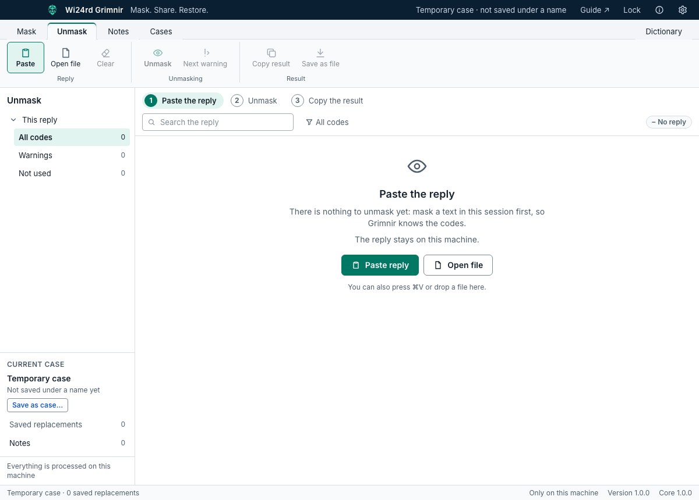
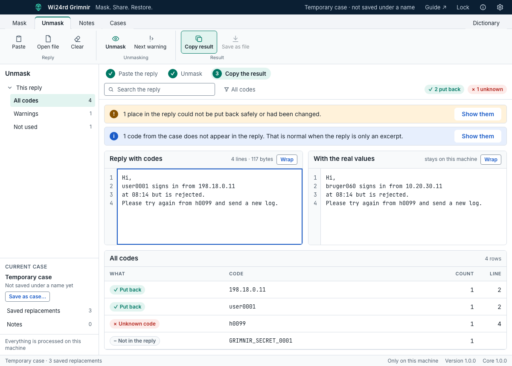
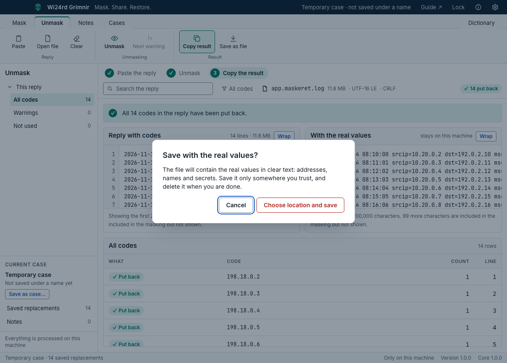

# Unmask

Shortcut: ⌘2

## What does it show?

Unmask is where you paste the reply from support or a chatbot and get the real values back in place of the codes. Grimnir uses the codes in the case that is open. At the top are the three steps: **Paste the reply**, **Unmask** and **Copy the result**.

*Unmask before the case has any codes: mask a text first, so Grimnir knows the codes.*

## How to do it

1. Copy the reply.
2. Press ⌘V in Unmask, or press **Paste reply**. A reply can be up to 8 MB; larger files you open with **Open file**.
3. Press **Unmask** (⌘↵).
4. Go through the warnings (see below).
5. Press **Copy result** (⇧⌘C).

If the reply belongs to another case than the open one, open that case first under **Cases** with **Open in Mask**. See [Cases](sager.md).

## The result

*The reply with codes on the left, **With the real values** on the right. Two codes are put back, one is unknown, and one code from the case is not in the reply.*

- **Reply with codes** is what you pasted.
- **With the real values** is the reply with your values. It stays on this machine.
- The table shows each code with **What**, **Code**, **Count** and **Line**.

The tree on the left filters the table: **All codes**, **Warnings** and **Not used**. **Next warning** (⌘G) jumps to the next warning in the reply.

## The warnings

A banner says how many places in the reply could not be put back safely or had been changed. **Show them** shows them. The column **What** says what happened:

| What | Means |
|---|---|
| **Put back** | The code has been replaced with the real value. |
| **Unknown code** | Something in the reply has the form of a code, but the case does not know it. It is left alone. |
| **Unknown address in the case network** | An address in one of the case's networks that the case does not know. |
| **Different upper/lower case** | The code appears with different upper and lower case than in the case. It has been put back. |
| **Machine without domain** | The machine stands alone where the original had the full name with domain. It has been put back. |
| **Domain alone** | The domain stands alone where the original only had it as part of a name. It has been put back. |
| **Escaped backslash** | The code appears escaped, as in JSON (`NB01\\user0001`). It has been put back. |
| **URL-encoded** | The code appears URL-encoded (e.g. `%40` or `%5C`). It has been put back. |
| **Not in the reply** | A code from the case does not appear in the reply. That is normal when the reply is only an excerpt. |
| **Looks like another case** | The reply has many codes the case does not know. It may belong to another case. |
| **Pool ran out: …** | There were no more codes of one kind, so some codes come from a reserve pool. |

If all codes in the reply have been put back, it says e.g. **All 3 codes in the reply have been put back.**

## Copy and save

- **Copy result** (⇧⌘C) copies the reply with the real values. Grimnir writes it to the clipboard itself with the marker for confidential content, so apps that keep a clipboard history and follow that marker can skip it. If Grimnir cannot write the marker, the text is copied without it. If it is still on the clipboard when Grimnir locks or quits, Grimnir removes it.
- **Save as file** is there when you opened the reply as a file. Grimnir asks first, because the file will have the real values in clear text.

*The question before an unmasked file is saved. **Choose location and save** opens the system's Save dialog.*

Save the file only somewhere you trust, and delete it when you are done. Grimnir does not know where it is and does not delete it.

## Clear

**Clear** removes the reply and the result. If the result has been neither copied nor saved, Grimnir asks first. The case is not touched.

## Click through

- **Show them** in a banner filters the table on the warnings or on the codes that were not used.
- A filter in the tree shows only those rows.
- **Open Cases** is in the empty view when you need to open the case the reply belongs to.
