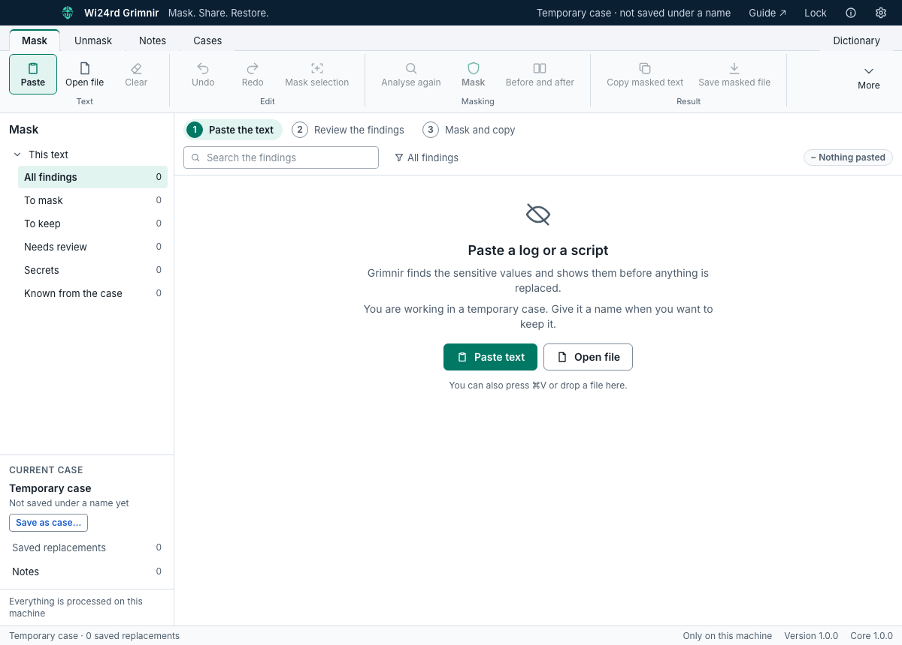
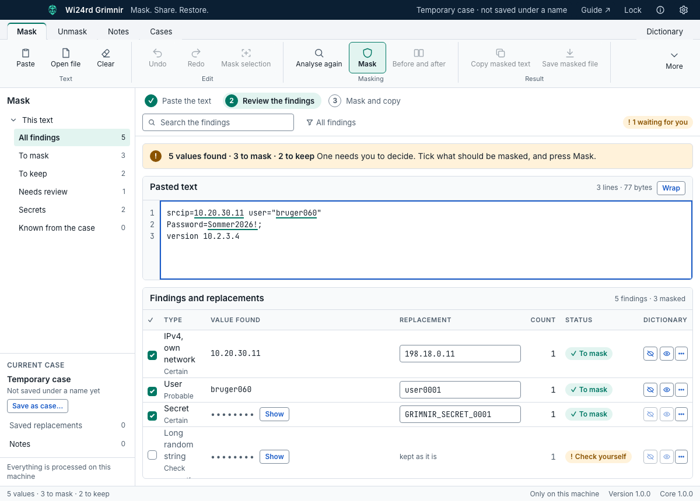
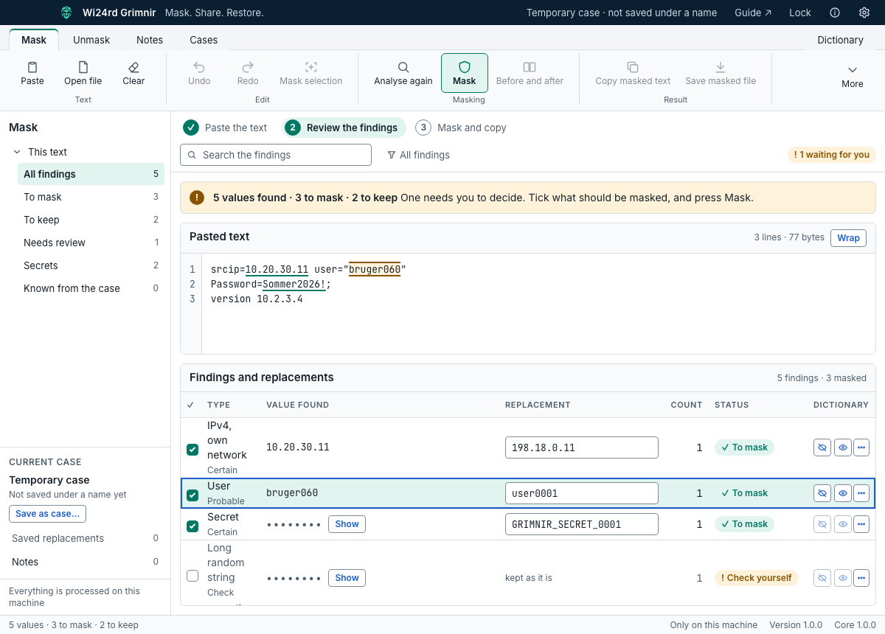
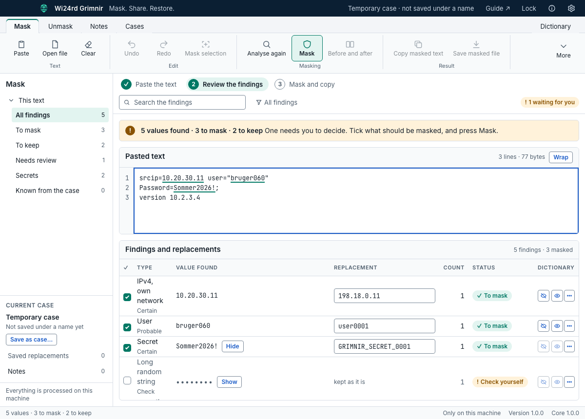
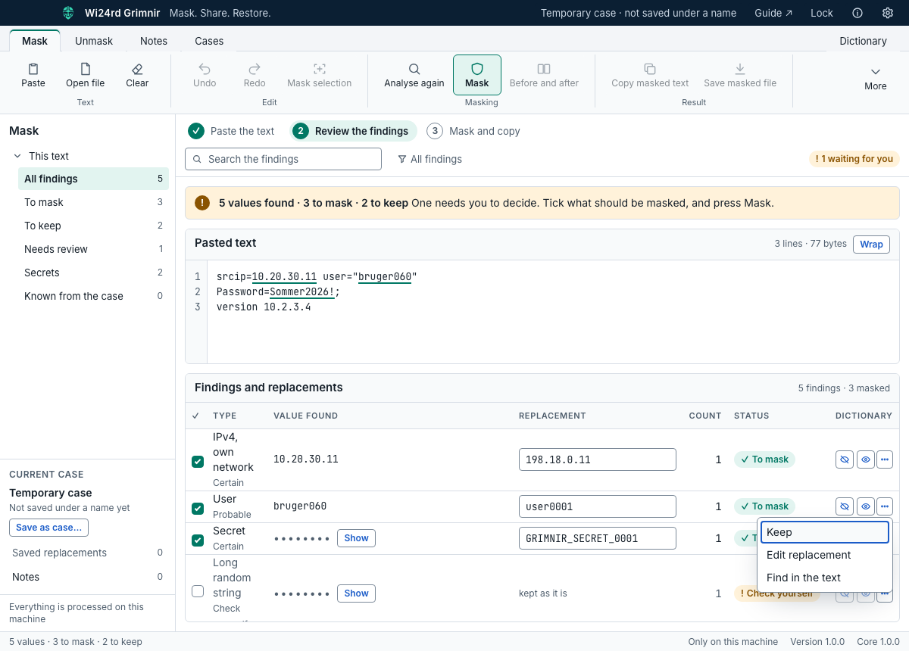
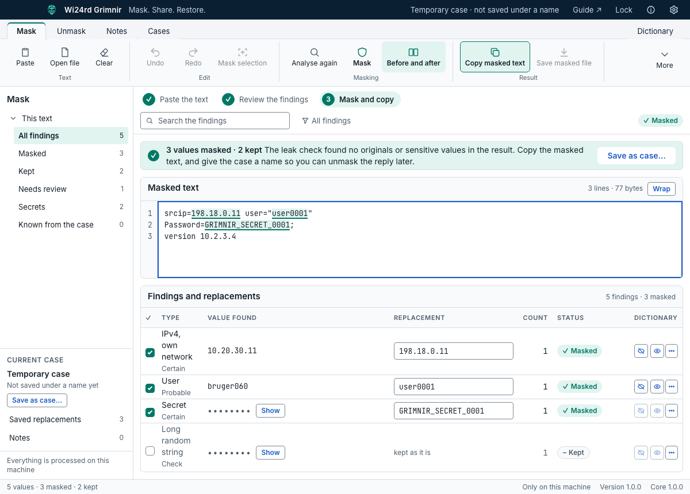
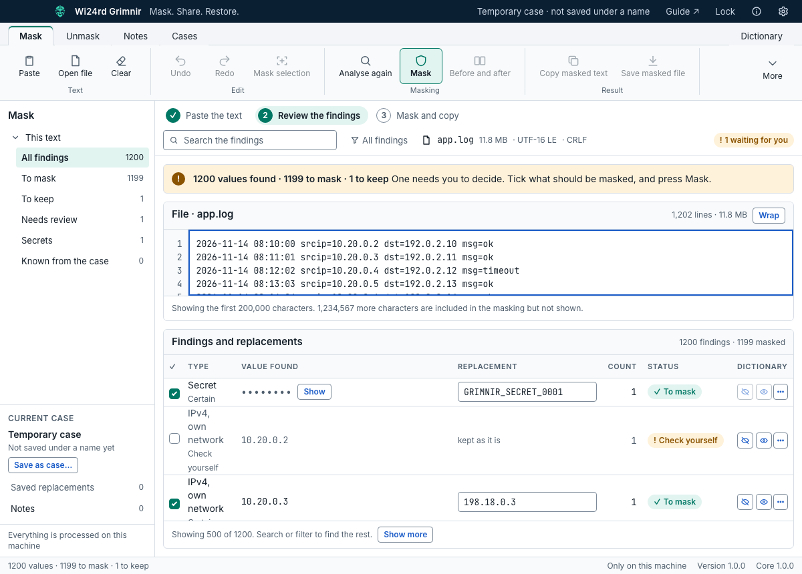
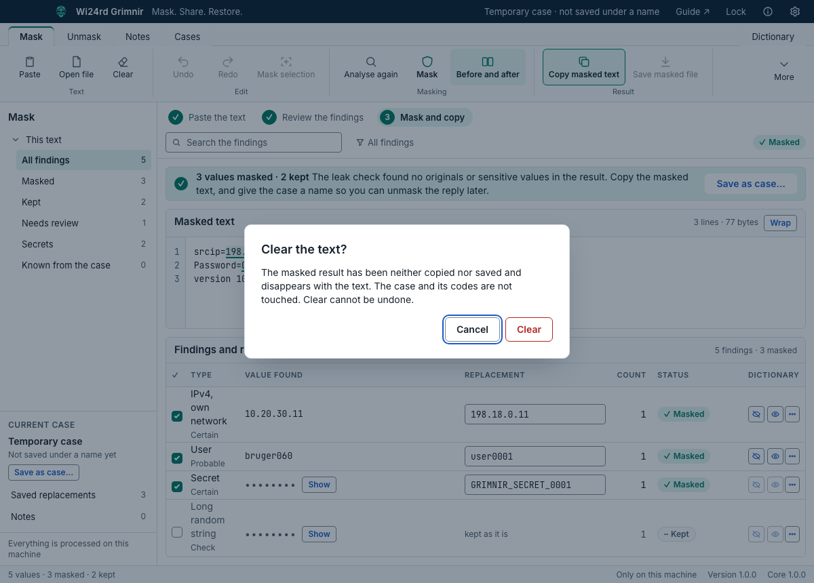
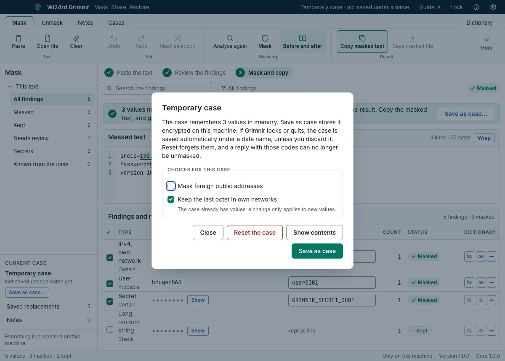

# Mask

Shortcut: ⌘1

## What does it show?

Mask is where you paste a log or a script, see what Grimnir found, and replace the values with codes. At the top are the three steps: **Paste the text**, **Review the findings** and **Mask and copy**. The step you are at is highlighted.

*Mask before anything is pasted. **Paste text** and **Open file** are in the middle of the window, and ⌘V works too.*

## How to do it

1. Copy the log or the script from where it is.
2. Press ⌘V in Mask, or press **Paste text**. Grimnir analyses the text straight away.
3. Go through the findings in the table **Findings and replacements**. Tick what should be masked, and untick what should be kept.
4. Press **Mask** (⌘↵).
5. Read the masked text, and press **Copy masked text** (⇧⌘C).
6. Paste the text into your email or chat.

A pasted text can be up to 5 MB. Larger files you open with **Open file** (see below).

## The findings

*The pasted text with line numbers and the values found underlined. The banner says how many values were found and how many need you to decide.*

Each row in the table is one value, however many places it appears. The columns:

| Column | Means |
|---|---|
| **✓** | Tick: the value is masked. Without a tick it is kept as it is. |
| **Type** | What Grimnir thinks the value is, e.g. **IPv4, own network**, **User** or **Secret**. Under the type it says how sure Grimnir is: **Certain**, **From dictionary**, **Probable**, **Check yourself** or **Version**. |
| **Value found** | The value as it appears in the text. A secret is shown as dots. |
| **Replacement** | The code the value gets. You can edit it in the field. |
| **Count** | How many places the value appears in the text. |
| **Status** | **To mask** or **To keep** (after masking **Masked** or **Kept**). |
| **Dictionary** | Add the value to the dictionary as **Always mask** or **Never mask**, and the row's **…** menu. |

Rows marked **Check yourself** are those Grimnir is not sure about, and **Version** is a value that stands as a version number. Neither is ticked from the start. Always go through them.

Public addresses also appear as rows, but are only ticked from the start if **Mask foreign public addresses** is turned on for the case (see [Settings](../50-indstillinger.md)).

The tree on the left filters the table: **All findings**, **To mask**, **To keep**, **Needs review**, **Secrets** and **Known from the case** (values the case already knew, which get the same code as last time). The field **Search the findings** searches codes and values.

*A click on a row marks the value everywhere in the pasted text.*

## Secrets

A secret, e.g. a password, is shown as dots in the table. **Show** shows the value in the row, and **Hide** hides it again. The value is only sent to the window when you choose **Show**, and the search does not find a hidden secret by its value. Secrets cannot be added to the dictionary.

*After **Show** the secret is in the row, and the button is called **Hide**. The pasted text at the top is as you pasted it; only the table hides the value.*

## The row's "…" menu

*The **…** menu on a row: **Keep** (or **Mask**), **Edit replacement** and **Find in the text**.*

- **Mask** and **Keep** do the same as the tick.
- **Edit replacement** lets you edit the code in the field **Replacement**. A replacement that already exists in the case or in the text cannot be used.
- **Find in the text** shows where the value is.
- **Remove** is on a value you added yourself with **Mask selection**.

## A value Grimnir did not find

1. Select the value in the pasted text, with the mouse or Shift + arrow keys (⌥ takes a word at a time).
2. Choose **Mask selection** (⇧⌘M) in the command bar or in the menu you get with a right-click. If it is a secret, choose **Mask as secret**.

Every place where the value stands as a whole word is included. A letter or digit right before or after makes it part of a longer word, and there it is not included. In an open file you select in the shown text (the first 200,000 characters); the row applies to the whole file.

**Undo** (⌘Z) and **Redo** (⇧⌘Z) work on your choices: ticks, replacements, types and added values. The history is cleared by **Mask**, a new text and **Clear**.

## After masking

*The masked text with the codes marked. The banner has the leak check's answer, and step 3 is current.*

- **Copy masked text** (⇧⌘C) copies the masked text. It can be copied up to 5 MB; a larger result you save as a file.
- **Save masked file** (⌘S) saves the result as a new file. It is there when you have opened a file; a pasted text is copied instead.
- **Copy receipt** copies a short text with the figures from the masking: how many values of each type were masked. It has no original value and no file name, only the case name.
- **Before and after** shows the pasted text again, so you can select in it.

The **leak check** goes through the result after masking. If it finds an original or something that still looks like a sensitive value, the banner says so, and **Show them** shows the places.

If you change a choice after masking, it says **The choices have changed. Press Mask again for a new result.**

## Open a file

Press **Open file** (⌘O), or drop the file on the window.

- The file can be up to 100 MB, in UTF-8 with or without a BOM or in UTF-16 with a BOM.
- The window shows the first 200,000 characters. The analysis and the masking apply to the whole file.
- The table shows 500 rows at a time. **Show more** shows more; search or filter to find the rest.
- Grimnir opens the file for reading only and never writes to it. **Save masked file** writes a new file, and it must not have the same name as the one the text came from.
- One file at a time. Folders and zip files cannot be opened.

*An open file: the name, the size and the character set are above the text, and the table shows the first 500 of 1200 findings.*

## A narrow window

When the window is narrow, the last commands in the command bar move under **More**. If the next step is one of them, **More** is highlighted, and the command is highlighted in the menu. Which commands move depends on the window's width, the language and the text size. After masking, the next step can be **Copy masked text**.

## Clear

**Clear** removes the text, the findings and your choices. If the result has been neither copied nor saved, Grimnir asks first. The case and its codes are not touched.

*The question **Clear the text?** comes when something would be lost. Clear cannot be undone.*

## The case in the title bar

A masking always belongs to a case. If you have not chosen one, it is the temporary case. The title bar shows **Temporary case · not saved under a name**, and a click opens the case dialog.

*The temporary case's dialog. **Choices for this case** only apply to new values when the case already has values.*

- **Save as case** gives the case a name and saves it encrypted.
- **Reset the case** forgets the case's values. A reply with those codes can then no longer be unmasked.
- **Show contents** shows the case's codes and values (see [Cases](sager.md)).

If Grimnir locks or quits, a temporary case with values is saved automatically under a name with the date and time, unless you discard it. See [The lock](../60-laasen.md).

## Click through

- A click on a row marks the value in the text. **Find in the text** in the row's menu does the same.
- A click on a filter in the tree shows only those rows.
- **Show them** in a banner shows the rows or places the banner talks about.
- **Saved replacements** under **Current case** on the left shows the case contents.
