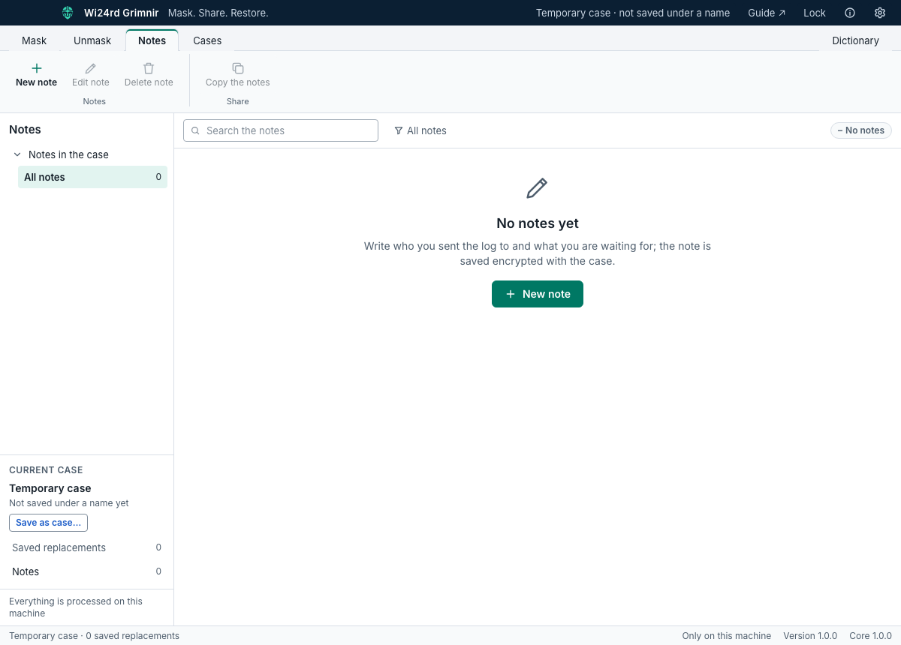
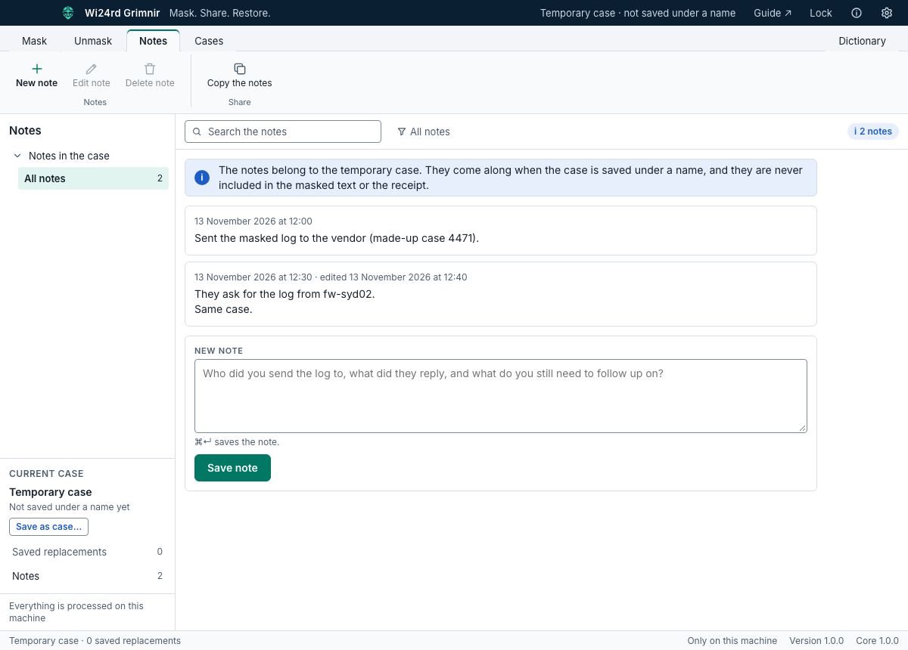
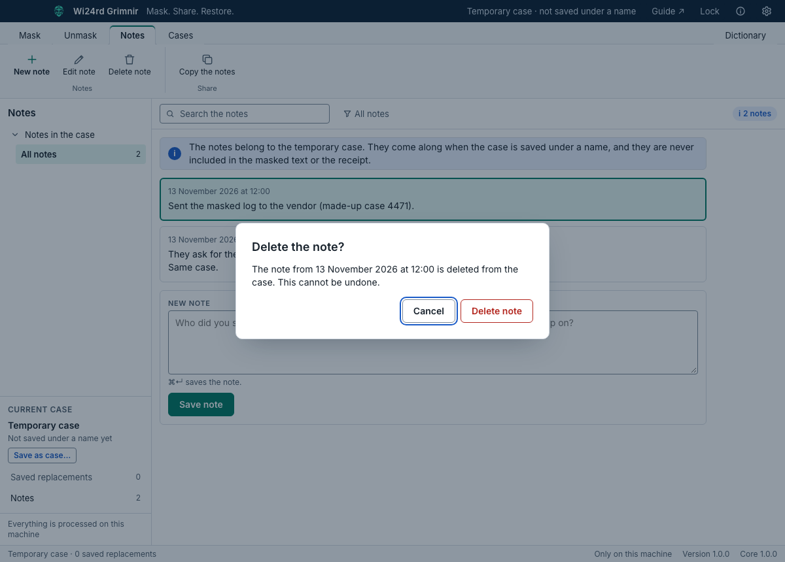

# Notes

Shortcut: ⌘3

## What does it show?

Notes are your own notes for the open case, also the temporary one: who you sent the log to, what they replied, and what you still need to follow up on. Each note has the date and time it was written and when it was last edited.

*Notes before the case has any. **New note** in the command bar starts one.*

## How to do it

1. Press **New note**. The cursor is in the field.
2. Write the note.
3. Press **Save note** or ⌘↵. While you edit a note, the button is called **Save**.

Select a note in the list to edit or delete it. **Edit note** opens it in the field; Esc cancels the edit. **Delete note** asks first.

*Two notes in the temporary case. The lower one has been edited, and it says so next to it.*

- A note can be at most 4,000 characters, and a case can have at most 200 notes.
- **Copy the notes** copies all the case's notes with the case name and the times. If they are still on the clipboard when Grimnir locks or closes, Grimnir removes them.
- **Search the notes** finds notes with a word.

*The question before a note is deleted. This cannot be undone.*

## What happens to the notes?

- The notes are saved encrypted together with the case. They are never included in the masked text or the receipt.
- Grimnir does not search the notes for values and does not mask them. So do not write anything in a note you do not want kept in the case.
- Notes in the temporary case come along when the case is saved under a name. If you discard the temporary case, the notes are lost.

## Click through

- **Notes** under **Current case** on the left opens the Notes tab with the number of notes.
- In **Cases** the column **Notes** shows how many notes each case has.
