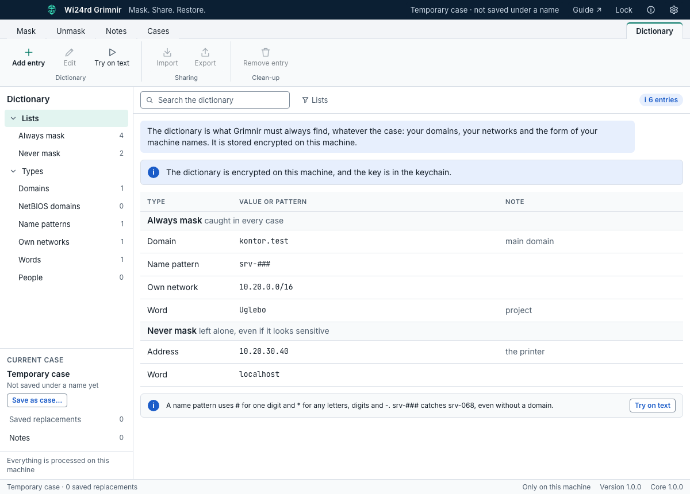
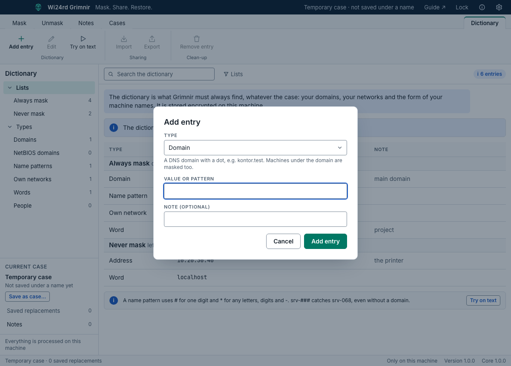
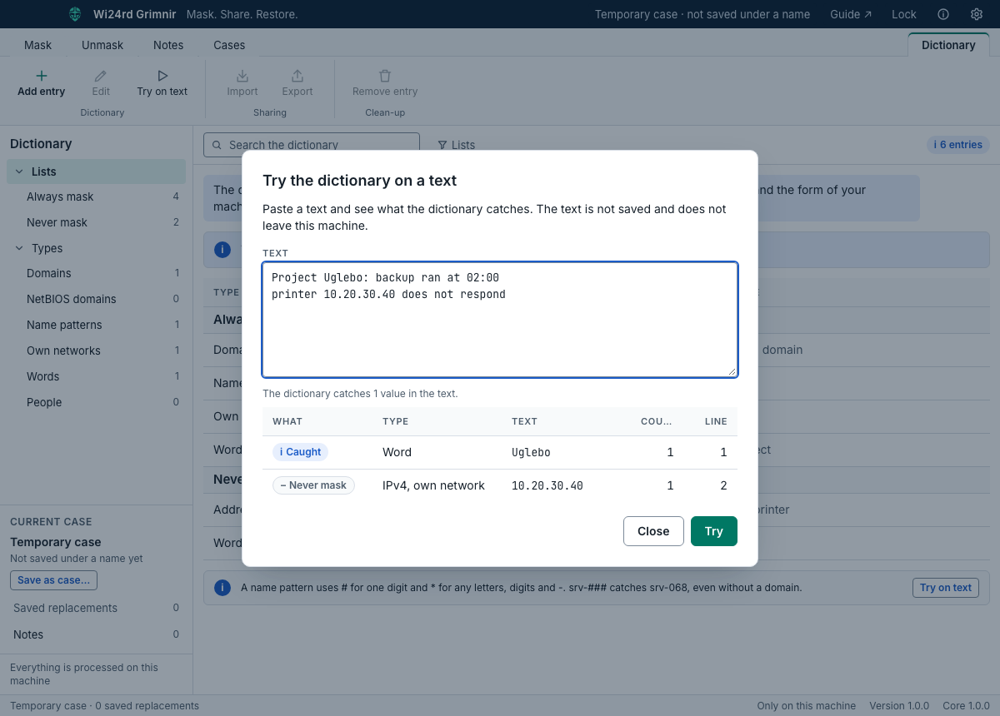
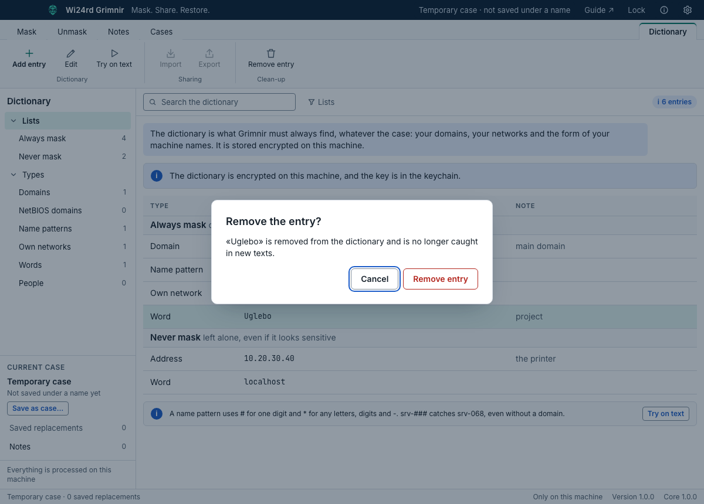

# Dictionary

Shortcut: ⌘5

## What does it show?

The dictionary is what Grimnir must always find, whatever the case: your domains, your networks and the form of your machine names. It is also what Grimnir must never touch. The dictionary applies in every case and is stored encrypted on your Mac with its key in the keychain.

*The two lists with type, value or pattern and a note. The tree on the left filters by list and type.*

The dictionary has two lists:

- **Always mask** (caught in every case).
- **Never mask** (left alone, even if it looks sensitive). A value on **Never mask** wins over everything else.

## The types

| Type | What you enter |
|---|---|
| **Domain** | A DNS domain with a dot, e.g. `kontor.test`. Machines under the domain are masked too. |
| **NetBIOS domain** | A NetBIOS domain without a dot, e.g. `KONTOR` (at most 15 characters). |
| **Name pattern** | `#` is one digit, `*` is any letters, digits and `-`. `srv-###` catches `srv-068`, even without a domain. |
| **Own network** | A network in CIDR form (address/prefix) or one address. The private networks under RFC 1918 are always your own; enter the others here. At most /8. |
| **Word** | A word that is always masked, e.g. a project or customer name (at least two characters). |
| **Person** | A person's name that is always masked. |
| **Never mask** | A value that is never masked: an address, a network, a domain or a word. |

Secrets cannot be added to the dictionary. If a value looks like a password, Grimnir says so.

## How to do it

### Add an entry

1. Press **Add entry**.
2. Choose **Type**, and enter **Value or pattern**.
3. Optionally enter a **Note (optional)**, e.g. what the value is (at most 200 characters).
4. Press **Add entry** in the dialog.

*Add entry. The help text under the field changes with the type.*

### From Mask

In the findings table under **Mask** each row has two buttons in the column **Dictionary**: **Always** (Always mask: add the value to the dictionary) and **Never** (Never mask: add the value to the dictionary). If several machine names in a text have the same form, Grimnir suggests the pattern in a banner with **Add to dictionary** and **Not now**.

### Try the dictionary on a text

Press **Try on text**, paste a text, and press **Try**. Grimnir shows what the dictionary catches. The text is not saved and does not leave this machine.

*Try on text: the word from the dictionary is shown as **Caught**, the address from **Never mask** as **Never mask**.*

### Edit or remove an entry

Select the entry, and press **Edit** or **Remove entry**. A removed entry is no longer caught in new texts.

*Remove the entry? The entry is removed from the dictionary and is no longer caught in new texts.*

**Import** and **Export** are greyed out: they are coming in a later version of Grimnir.

## Click through

- An item in the tree (**Always mask**, **Never mask** or a type) shows only those entries.
- **Search the dictionary** searches the entries.
- **Try on text** is also in the banner below the list.
