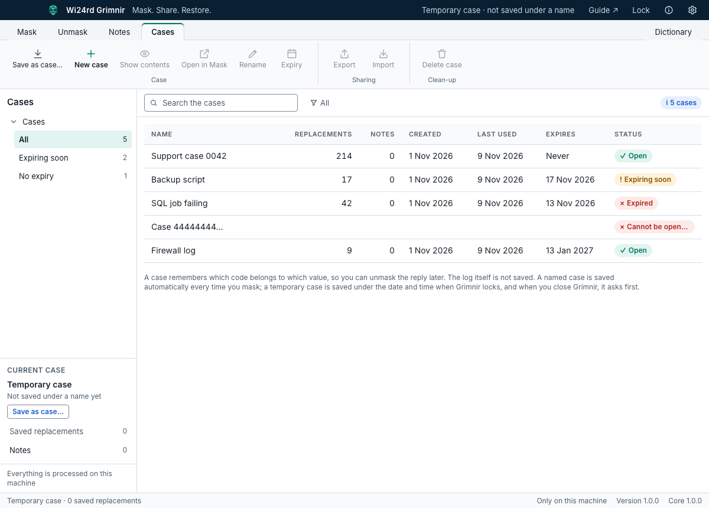
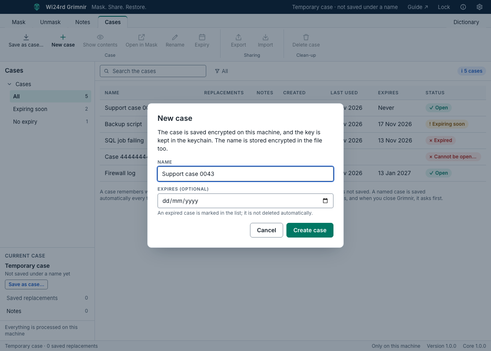
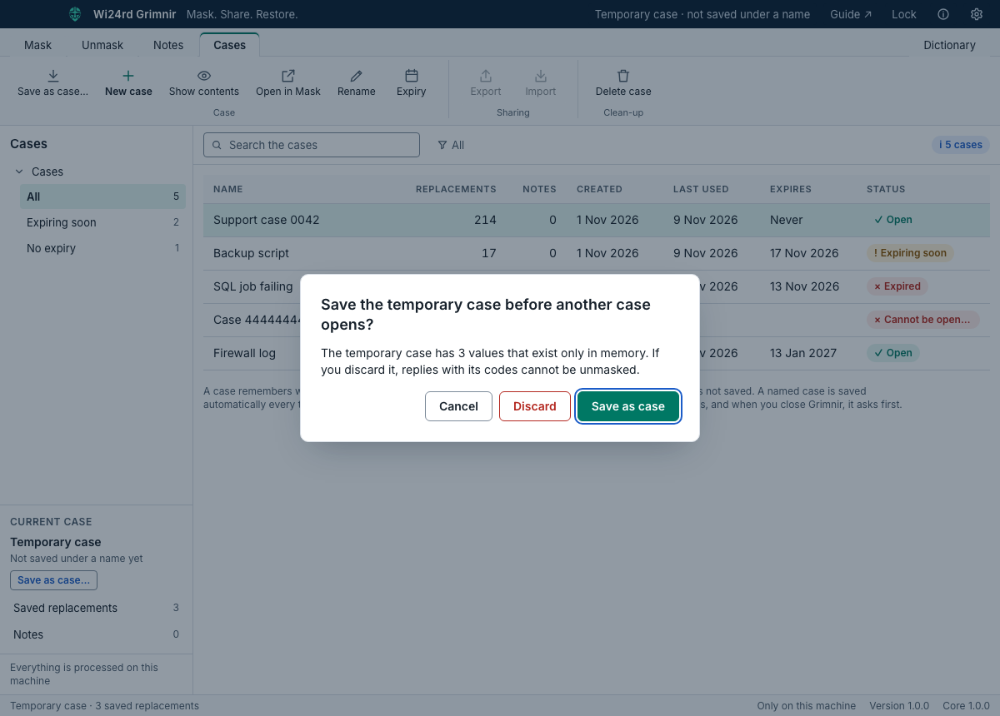
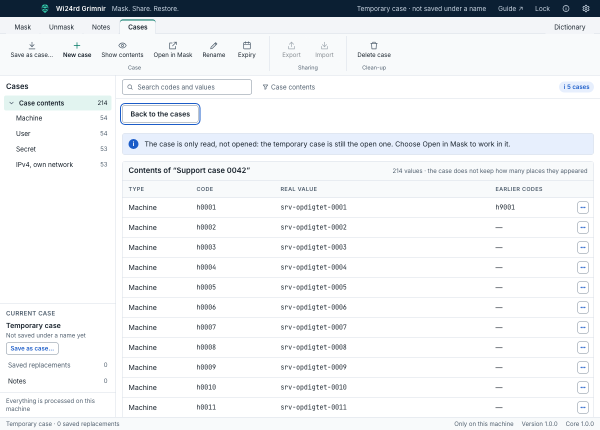
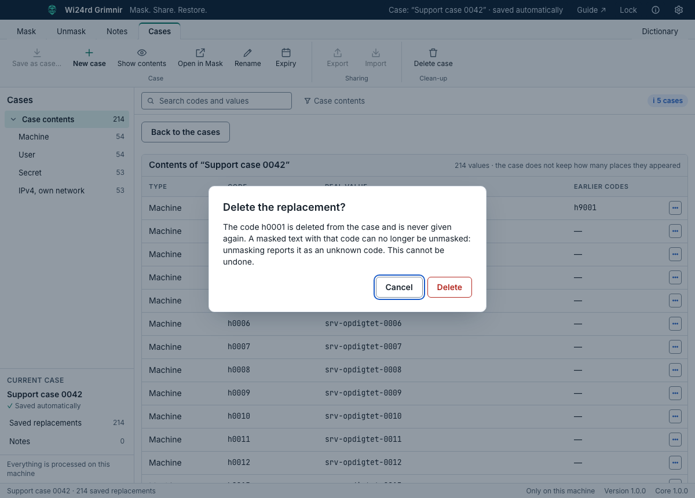
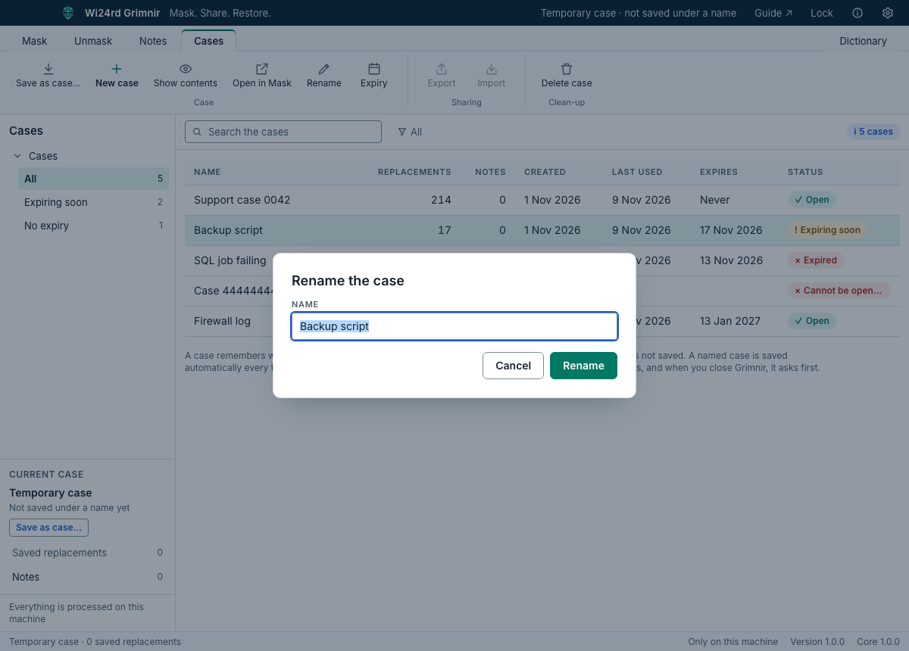
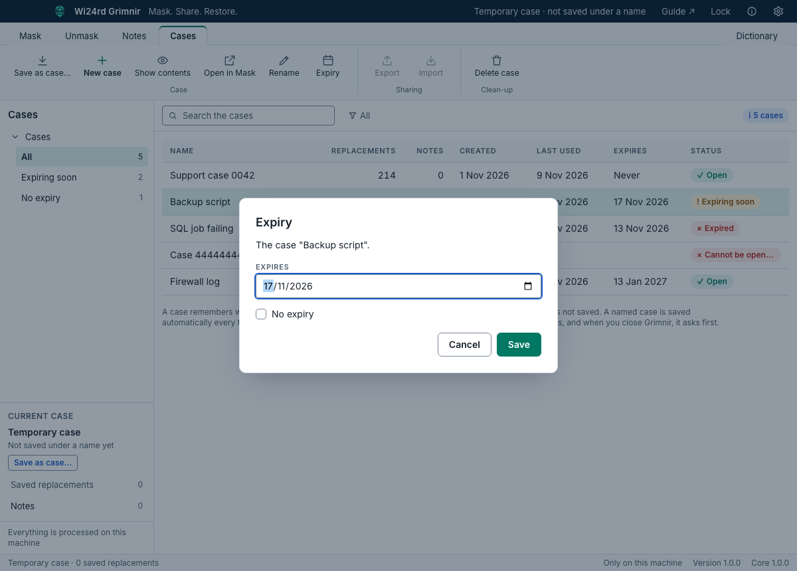
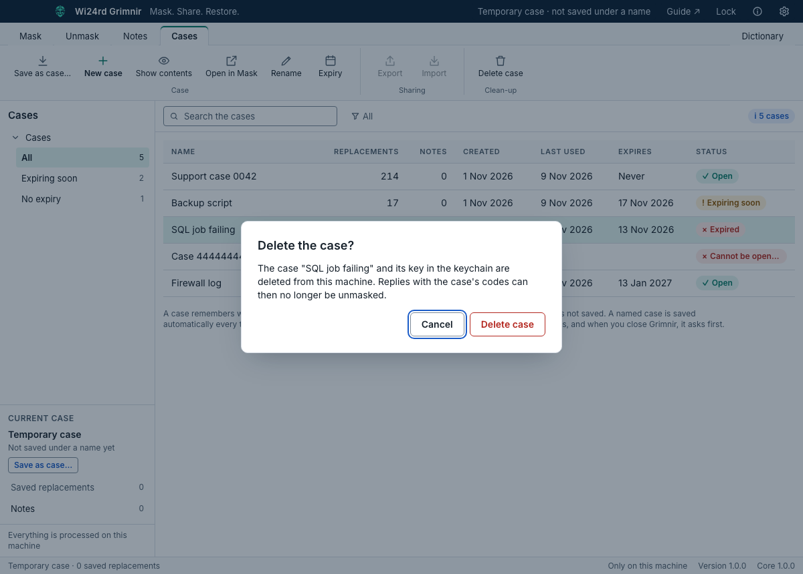

# Cases

Shortcut: ⌘4

## What does it show?

A case remembers which code belongs to which value, so you can unmask the reply later. The log itself is not saved. Each case is one encrypted file on your Mac with its own key in the keychain. Cases shows the list of your saved cases.

*Five cases: two are open, one is expiring soon, one has expired, and one cannot be opened.*

| Column | Means |
|---|---|
| **Name** | The case name. A case that cannot be opened is called **Case** and the start of its id, because the name is only stored encrypted in the file. |
| **Replacements** | How many values the case remembers. |
| **Notes** | How many notes the case has. |
| **Created** and **Last used** | The dates. |
| **Expires** | The case's expiry, or **Never**. |
| **Status** | **Open**, **Expiring soon** (within 7 days), **Expired** or **Cannot be opened**. If you hold the mouse over a case that cannot be opened, the tooltip says why. |

The tree on the left filters: **All**, **Expiring soon** (including the expired ones) and **No expiry**. **Search the cases** searches the names.

## The temporary case and named cases

- **The temporary case** is the one you work in when you have not chosen a case. It exists only in memory. If Grimnir locks or quits, it is saved automatically as a named case with the date and time as its name, if it has values. If you close Grimnir yourself, Grimnir asks first.
- **A named case** is saved automatically every time you mask.

## How to do it

### Save the temporary case under a name

Press **Save as case…** (in the command bar, under **Current case** on the left or in the case dialog in the title bar). Enter a name, choose an expiry if you like, and press **Create case**. The temporary case with its values and notes becomes the new case.

### Create a new case

*New case. **Expires (optional)** suggests the default expiry from Settings.*

Press **New case**. The name must be 1–120 characters without line breaks. If a named case is open, it is closed (it is saved), and the new case starts empty.

### Open a case

Select the case, and press **Open in Mask**. Then you mask and unmask with that case's codes. If the temporary case has values, Grimnir asks first:

*Three answers: **Cancel**, **Discard** and **Save as case**. If you discard, replies with the temporary case's codes cannot be unmasked.*

The open case appears in the title bar as **Case: “name” · saved automatically**. A click opens the case dialog with **Close case**, which closes the case here; the file stays.

### See the case contents

Press **Show contents**, press Enter, or double-click the case. The contents show each value with **Type**, **Code**, **Real value** and **Earlier codes**. The case does not keep how many places the values appeared.

*The case contents, only read: the banner says the open case is still the temporary one. **Back to the cases** (or Esc) goes back to the list.*

The row's **…** menu has **Copy value** and **Delete**:

- **Copy value** copies the real value. Grimnir writes it to the clipboard itself with the marker for confidential content and removes it on lock and quit if it is still there. A secret never passes through the window.
- **Delete** deletes a replacement from the case. This can only be done in the open case; open it in Mask first.

*The deleted code is never given again. A masked text with that code can no longer be unmasked. This cannot be undone.*

### Rename

*Rename the case. The name is only stored encrypted in the file.*

### Set an expiry

*Expiry for a case. Choose a date, or tick **No expiry**.*

An expired case is marked in the list; it is not deleted automatically, and its codes can still be unmasked.

### Delete a case

*Delete the case? **Cancel** has the focus.*

**Delete case** deletes the case file and its key in the keychain from your Mac. Replies with the case's codes can then no longer be unmasked.

**Export** and **Import** are greyed out: they are coming in a later version of Grimnir.

## Click through

- Enter or a double-click on a case shows its contents.
- A filter in the tree shows only those cases.
- **Saved replacements** under **Current case** on the left shows the open case's contents.
