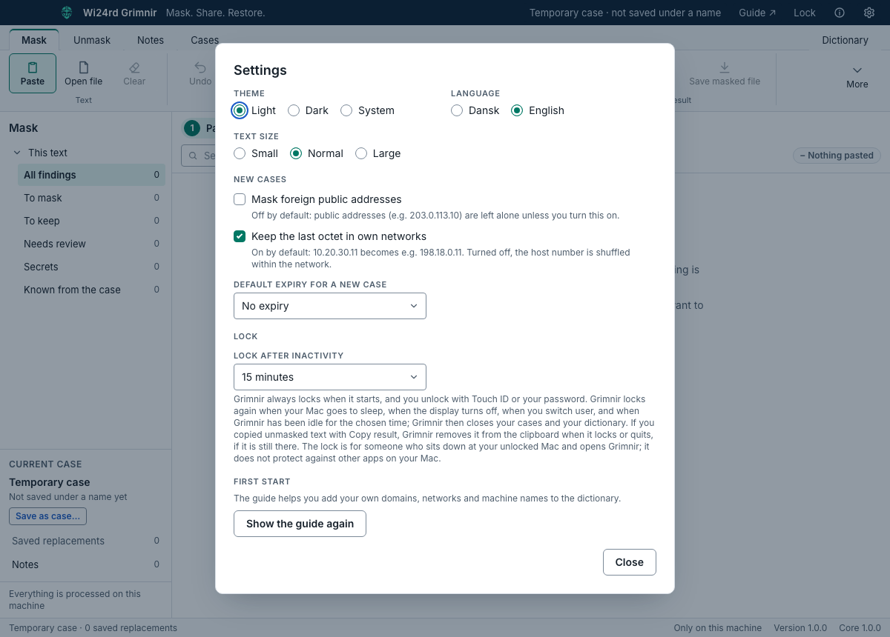
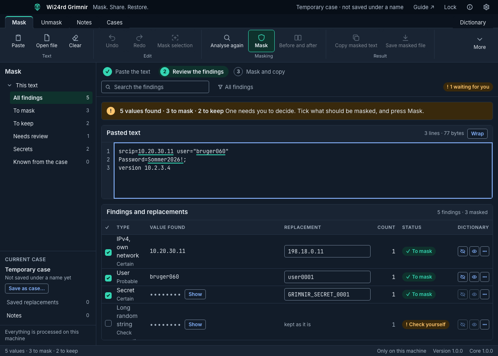
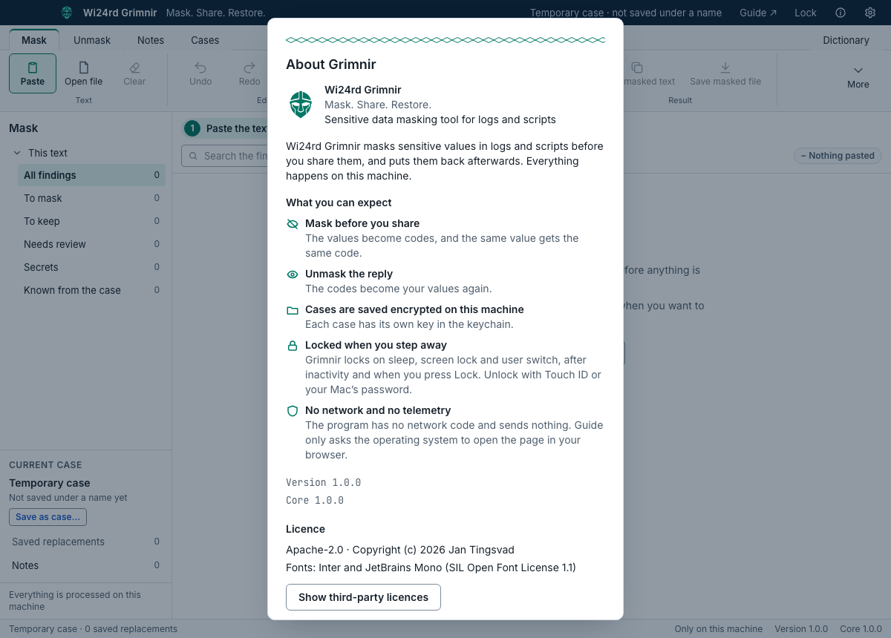

# Settings

Open **Settings** with the gear at the top right, with ⌘, or in the menu **Grimnir** → **Settings…**. A choice is saved as soon as you change it. **Close** closes the dialog. Settings also work while Grimnir is locked; only **Show the guide again** is greyed out.

*All settings in one dialog. Under each choice it says what it does.*

## Theme, language and text size

| Field | Choices | Default | Effect |
|---|---|---|---|
| **Theme** | **Light**, **Dark**, **System** | **System** | The colours of the whole window. **System** follows macOS. |
| **Language** | **Dansk**, **English** | **Dansk** | The language of the window. Changes straight away. |
| **Text size** | **Small**, **Normal**, **Large** | **Normal** | The size of all text in the window. ⌘+, ⌘− and ⌘0 and the menu **View** do the same. |

*Mask in the theme **Dark**.*

## New cases

The choices apply to new cases. A case that already exists has its own choices in the case dialog in the title bar (**Choices for this case**).

| Field | Choices | Default | Effect |
|---|---|---|---|
| **Mask foreign public addresses** | on or off | off | Off: public addresses (e.g. 203.0.113.10) are left alone unless you turn this on. |
| **Keep the last octet in own networks** | on or off | on | On: 10.20.30.11 becomes e.g. 198.18.0.11. Turned off, the host number is shuffled within the network. |
| **Default expiry for a new case** | **No expiry**, **30 days**, **90 days** | **No expiry** | The expiry **New case** suggests. It also applies to a temporary case that is saved on lock or quit. |

## Lock

| Field | Choices | Default | Effect |
|---|---|---|---|
| **Lock after inactivity** | **5 minutes**, **15 minutes**, **30 minutes**, **60 minutes** | **15 minutes** | Grimnir locks when it has been idle for that time: no keyboard or mouse in the window and no work in progress. There is no setting that turns the lock off. |

When else Grimnir locks, and what happens on lock, is in [The lock](60-laasen.md).

## First start

**Show the guide again** opens the guide from the first start, so you can add more domains, networks and machine names to the dictionary. See [Setup](30-opsaetning.md).

## About Grimnir

You open **About Grimnir** with ⓘ at the top right or in the menu **Grimnir** → **About Grimnir**.

*About Grimnir: what you can expect from the program, the version of the program and of the core, the licence and the fonts.*

- **Version** and **Core** are the versions of the program and of the masking core. They are also at the bottom right of the window.
- **Show third-party licences** shows the licences for the components Grimnir is built with.
- **Open the guide** asks the operating system to open this guide in your browser.
