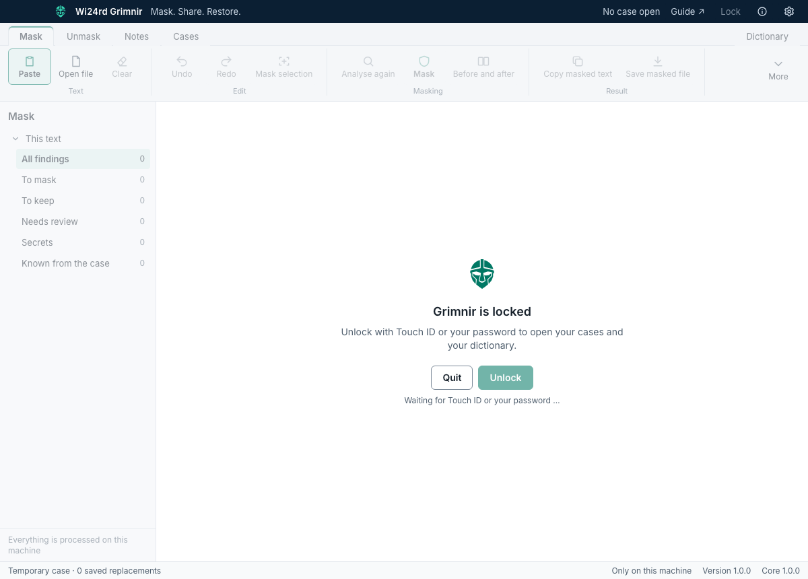

# The lock

Grimnir sends no notifications. It has no icon in the menu bar, does not run in the background and does not start at login. What looks like a background feature is the lock: it watches for when you step away from the Mac.

## The lock screen

*The lock screen while macOS asks for Touch ID or the password. The tabs, the command bar and the current case are dimmed.*

- **Unlock** (or Enter) asks macOS for Touch ID. The password is the fallback.
- **Quit** closes Grimnir.
- While Grimnir is locked, nothing from your cases or your dictionary is in the window. **Settings**, **About Grimnir** and **Guide** still work.

## When Grimnir locks

Grimnir always locks when it starts. It locks again:

- when your Mac goes to sleep,
- when the display turns off,
- when you switch user,
- when Grimnir has been idle for the time you chose under **Lock after inactivity** (5, 15, 30 or 60 minutes; default 15),
- when you press **Lock** in the title bar.

The lock cannot be turned off. After a new lock, Grimnir does not ask for Touch ID by itself. The lock screen says **Grimnir locked while you were away. Press Unlock to continue.**

## What happens when Grimnir locks

1. **The clipboard:** what Grimnir itself copied with **Copy result**, **Copy the notes** or **Copy value** is removed if it is still on the clipboard. If something else has written to the clipboard since, it is not touched. Masked text and other apps' content are never touched.
2. **The texts:** the pasted text, the reply, the results and an open file disappear from Grimnir.
3. **The case:** a named case that has changed is saved. A temporary case with values is saved as a named case with the date and time as its name and with the default expiry from **Settings**.
4. **The dictionary** is closed and read again after you have unlocked.

When you have unlocked, a banner says what happened, e.g. **The temporary case was saved as "…".** The saved case does not open by itself; you find it under **Cases**.

## When you quit

If you quit Grimnir with ⌘Q, with **Quit Grimnir** in the menu or by closing the window while the temporary case has values, Grimnir asks first: **Save the temporary case before Grimnir quits?** The answers are **Cancel**, **Discard** and **Save as case**.

If Grimnir quits in a way that does not ask (Quit from the Dock, log out, restart or shut down), the temporary case is saved as on lock, and the name is shown in a banner after the next unlock. The clipboard is cleared on quit in the same way as on lock.

If Grimnir is forced to quit, crashes, or the power goes, Grimnir does not get to save or clear anything.

## When Touch ID does not work

| Line on the lock screen | Means |
|---|---|
| **Grimnir is still locked. Press Unlock to try again.** | You cancelled. Press **Unlock**. |
| **Your identity could not be confirmed. Grimnir is still locked.** | macOS could not confirm you. Press **Unlock** and try again. |
| **The operating system could not confirm who you are (error …). Grimnir is still locked.** | macOS answered with an error code. Try again; see [Troubleshooting](80-fejlfinding.md). |
| **Grimnir could not ask to be unlocked. Grimnir is still locked.** | Grimnir got no answer. Quit, and start Grimnir again. |

If your user account has no password, the Mac cannot confirm who you are. Then Grimnir unlocks without asking, and a banner says **This machine cannot confirm who you are. Grimnir is not locked.**

## What the lock does not protect against

The lock is for someone who sits down at your unlocked Mac and opens Grimnir. It does not protect against other apps on your Mac, and it does not protect a file you saved from **Unmask**. Lock your Mac when you step away from it.
